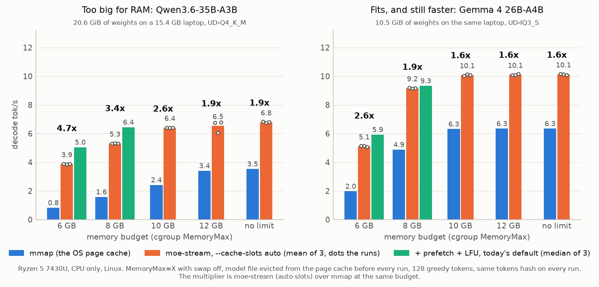
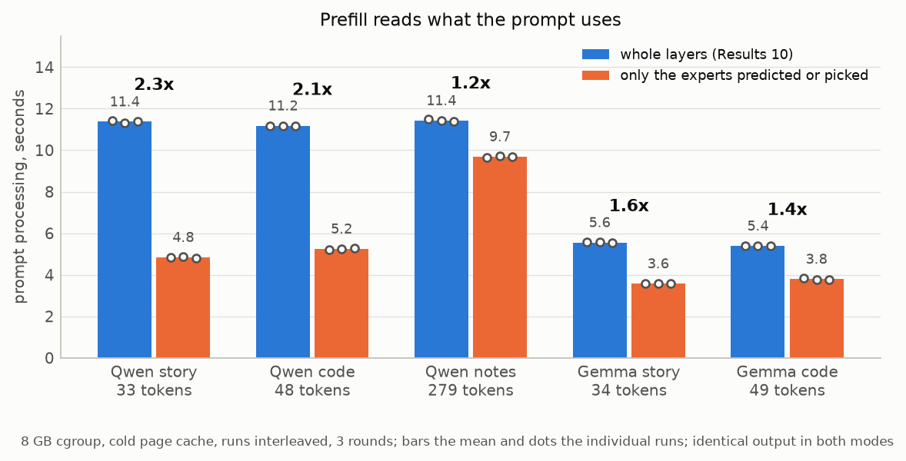
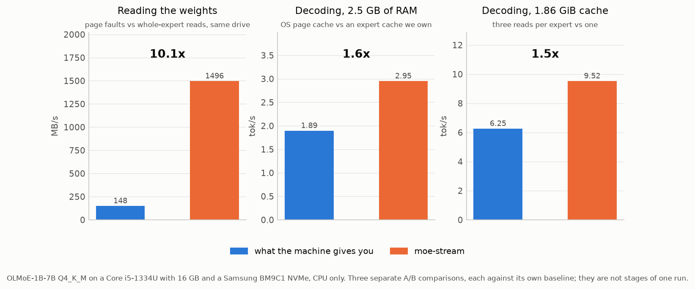

# moe-stream

[](https://github.com/Wok3b/moe-stream/actions/workflows/build.yml)
[](https://github.com/Wok3b/moe-stream/releases)
[](LICENSE)

**Bigger than your RAM. Faster than mmap. Bit-exact.**

moe-stream runs Mixture-of-Experts models from an SSD on an ordinary laptop: no
discrete GPU, 16 GB of RAM, an NVMe drive. Models bigger than the machine's
memory, and models that fit while using only part of it. The experts stay on
disk and are streamed into an explicit, locked cache that predicts what the next
layer needs, instead of being demand-paged one 4 KB fault at a time by the
operating system. It is a small set of commits on top of llama.cpp, and it
generates exactly the same tokens as llama.cpp's own mmap path.

<picture>
  <source media="(prefers-color-scheme: dark)" srcset="docs/img/dark/fig9-budgets.png">
  
</picture>

- **Too big for RAM.** Qwen3.6-35B-A3B is 20.6 GiB on a 15.4 GB laptop.
  moe-stream decodes it at **6.4 tok/s inside an 8 GB cgroup** and 6.8 with no
  limit. Memory-mapped, the same model manages 0.8 to 3.5, and it gets slower
  the less memory it has.
- **Fits, and still faster.** Gemma 4 26B-A4B (10.5 GiB) runs at **10.1 tok/s**
  against mmap's 6.3, and at 9.3 tok/s in 8 GB, leaving the other half of the
  machine free. mmap in the same 8 GB: 4.9.

| on a Ryzen 5 7430U, 15.4 GB, CPU only | weights | mmap decode | moe-stream decode | |
|---|---|---|---|---|
| Qwen3.6-35B-A3B UD-Q4_K_M, 6 GB budget | 20.6 GiB | 0.82 tok/s | **5.05 tok/s** | 6.2x |
| Qwen3.6-35B-A3B UD-Q4_K_M, 8 GB budget | 20.6 GiB | 1.58 tok/s | **6.44 tok/s** | 4.1x |
| Qwen3.6-35B-A3B UD-Q4_K_M, no limit | 20.6 GiB | 3.53 tok/s | **6.79 tok/s** | 1.9x |
| Gemma 4 26B-A4B UD-IQ3_S, 6 GB budget | 10.5 GiB | 1.97 tok/s | **5.93 tok/s** | 3.0x |
| Gemma 4 26B-A4B UD-IQ3_S, 8 GB budget | 10.5 GiB | 4.88 tok/s | **9.33 tok/s** | 1.9x |
| Gemma 4 26B-A4B UD-IQ3_S, no limit | 10.5 GiB | 6.35 tok/s | **10.14 tok/s** | 1.6x |

mmap runs start with the model out of the page cache, as after a reboot; the
6 and 8 GB moe-stream numbers are today's defaults (prefetch + LFU), the others
`--cache-slots auto`. Every cell is in [docs/NOTES.md](docs/NOTES.md), Results
11 to 17, with the raw logs in `bench/results/linux/`.

## Quickstart

Linux, with a C++ compiler, CMake and git:

```bash
git clone --recursive https://github.com/Wok3b/moe-stream && cd moe-stream
./build.sh
./run.sh qwen
```

Then open **http://127.0.0.1:8080** and chat. The first `./run.sh qwen` offers
to download the model (22.1 GB, checked against its SHA-256) into `~/models`;
after that it starts straight away. The expert cache sizes itself from the
memory you have.

| | |
|---|---|
| `./run.sh gemma` | Gemma 4 26B-A4B instead (11.3 GB download) |
| `./run.sh qwen --mem 8` | stay inside 8 GB and leave the rest of the machine alone |
| `./run.sh qwen --no-limit` | use all the free RAM, the fastest (also the default) |
| `./run.sh qwen --ctx 64k` | a longer context (default 16k, `--ctx max` for the full 256k) |
| `./run.sh gemma --no-think` | answer straight away; both models reason first by default, which at ~10 tok/s can add minutes per reply |
| `./run.sh ~/models/any-moe.gguf` | any other MoE GGUF |
| `./run.sh qwen --port 9000` | anything else goes to `llama-server` |

### How much context?

Both models take up to 256k tokens. The context's memory comes out of the same
budget as the expert cache: about **20 MiB per 1k tokens** on either model, so
the default 16k costs about 0.4 GB, 64k about 1.3 GB and the full 256k about
5 GB. The cache sizes itself after the context is allocated, so nothing breaks;
each extra GB of context is about 14 fewer cache slots and somewhat slower
decoding, which matters most under a tight `--mem`.

The practical limit is time, not memory: a long prompt has to be read through
every layer's experts. On Qwen in 8 GB a 756-token prompt takes 22 s, so a
pasted document of several thousand tokens takes minutes before the first
reply token. Short prompts and long conversations built up turn by turn are
the sweet spot. `run.sh` serves one request at a time (`-np 1`), which leaves
the most memory for the cache; pass `-np 4` to serve several.

On Windows, `.\build.ps1` builds the same tools with Visual Studio. [SETUP.md](SETUP.md)
has the server's `MOE_*` settings, the `llama-moe-run` benchmark tool and
everything else.

## How it works

1. **An expert cache we own.** Experts live in locked slots in our own memory,
   filled by `O_DIRECT` / unbuffered reads on an I/O thread pool, and addressed
   through a rewritten `ffn_moe_slot_ids` tensor so `mul_mat_id` indexes the
   cache instead of the model. The page cache is out of the picture.
2. **Sized from the memory there is.** `--cache-slots auto` takes the cgroup's
   `memory.max` (or free RAM less 15%), subtracts the dense weights, the stream
   buffers and a reserve, and fills the rest. Too many slots is worse than none,
   because the dense weights start faulting, so it never guesses high.
3. **The next layer is predicted, not waited for.** Layer L+1's router applied
   to the residual entering layer L picks most of the experts L+1 will use. A
   predictor thread inside the cache reads them while L computes.
4. **Eviction by decayed use counts.** Replayed traces showed LFU with a
   half-life of 8 tokens beats LRU on both models, and makes a wrong guess the
   first thing evicted.
5. **Prefill reads what the prompt picks.** Prompt batches stream through
   per-layer buffers that hold only the experts predicted or picked, not the
   whole layer:

<picture>
  <source media="(prefers-color-scheme: dark)" srcset="docs/img/dark/fig10-prefill.png">
  
</picture>

**The correctness check that matters:** the `tokens hash` printed by
`llama-moe-run` must be identical with and without `--cache-slots`, for the same
prompt and greedy sampling. If it is not, the cache is serving the wrong
weights. Every run behind the charts above passes it.

## Where it started: why the page cache cannot keep up

The first half of the project measured *why* mmap fails, on a smaller model
(OLMoE-1B-7B Q4_K_M, 3.92 GiB) and a different laptop (Core i5-1334U, 16 GB,
Samsung BM9C1 NVMe, Windows). **Read the write-up: [Why a 16 GB laptop can't run
a big MoE model from SSD, and what I built to fix
it](docs/streaming-moe-on-a-laptop.md).**

<picture>
  <source media="(prefers-color-scheme: dark)" srcset="docs/img/dark/fig0-headline.png">
  
</picture>

- **The drive is not slow, the requests are.** Demand paging moved **148 MB/s**
  on a drive that does **1496 MB/s** for expert-sized random reads, at 25 000 to
  50 000 faults per token. `PrefetchVirtualMemory` hints bought 0 to 25%.
- **Owning the I/O path: 1.42x to 1.56x** at an equal RAM budget, with page
  faults per token down to around 850.
- **One contiguous home per expert: 1.52x to 1.61x more.** `llama-moe-bundle`
  writes a sidecar with each expert's matrices back to back, so a miss is one
  read instead of three. The GGUF is untouched.
- **Prediction is free:** the stale router picks the exact top-8 84% of the
  time. **There is no hot set** on OLMoE (38 of 64 experts cover 80% of
  picks). **K=4 is not free:** +41 to +87% perplexity.

<p align="center">
  <picture>
    <source media="(prefers-color-scheme: dark)" srcset="docs/img/dark/fig4-stale-router.png">
    
  </picture>
  <picture>
    <source media="(prefers-color-scheme: dark)" srcset="docs/img/dark/fig7-ppl-vs-k.png">
    
  </picture>
</p>

## Reproducing the measurements

Linux, with a user systemd (no root needed):

```bash
MODEL=~/models/Qwen3.6-35B-A3B-UD-Q4_K_M.gguf PROMPT=bench/prompts/qwen36-story.txt \
  SLOTS=auto TAG=qwen bench/mem-budget.sh 6G 8G 10G 12G infinity
```

`mem-budget.sh` runs mmap and the cache under `MemoryMax`, with the model file
evicted from the page cache before every run (`bench/evict-file.py`). Every
figure is regenerated by `python bench/make-charts.py` from the files in
`bench/results/`, so the charts and the raw data cannot drift apart. The
Windows harness (`bench/*.ps1`) is described in [SETUP.md](SETUP.md).

## Layout

```
build.sh         build everything (build.ps1 on Windows)
run.sh           download a model and serve it with the expert cache
patches/         our llama.cpp commits as patch files, for reading
tools/moe-run/   the expert cache, router predictor and llama-moe-run,
                 plus llama-moe-bundle, the expert-bundled layout converter
tools/moe-trace/ dump router decisions per layer and token
bench/           measurement harness (shell, Python, PowerShell)
bench/results/   raw moe-run / llama-bench output and the CSV summaries
docs/            the write-up, and NOTES.md: every result in the order measured
llama.cpp/       submodule: Wok3b/llama.cpp, branch moe-stream (upstream 972d231 + our commits)
```

## Status

Done and measured, in [docs/NOTES.md](docs/NOTES.md) in the order taken,
including what did not work: the page-cache baseline and the failed prefetch
spike (Results 1-5), the explicit cache and bundled layout (6-8), Gemma 4 and
`llama-server` (9-10), the Linux port under cgroup budgets (11), a model twice
the size of RAM (12), auto sizing (13), prefetch that pays (14), LFU eviction
(15), clang vs GCC, no difference (16), prompt-aware prefill (17), a
head-to-head with Colibri (18), and a 3 s start-up (19).

Next, in the order it matters:

1. **Cheaper wrong guesses.** Prefetch costs 30% more reads; guesses that land
   only in free or cold slots could keep that without evicting hot experts.
2. **Bundled sidecar for the big models**: one read per miss instead of two or
   three, worth 1.5x on OLMoE.
3. **The shared expert during the miss wait.** Qwen's shared expert does not
   depend on routing, so computing it while misses load hides I/O.
4. **Upstream.** The expert-cache hook is small and architecture agnostic, and
   llama.cpp is already moving this way with `--load-mode dio` and lazy tensors.

## Prior art

The x86 counterpart to what [Edge0](https://github.com/Edge0-AI/Edge0) does on
Apple Silicon with MLX. The ideas it builds on are credited in
[docs/NOTES.md](docs/NOTES.md): Pre-gated MoE, LLM in a flash, PowerInfer-2,
MoE-Infinity, Fiddler, ExpertFlow, HOBBIT, and llama.cpp itself, which is the
baseline every number here is measured against.

[Colibri](https://github.com/JustVugg/colibri) works the same way in its own
pure-C engine and weight format: dense weights in RAM, routed experts streamed
from disk through a per-layer cache, with optional Vulkan and CUDA tiers. It
predates moe-stream, but it was not an inspiration for it: I only came across
it in October 2026, after the design here was in place. A head-to-head on this
laptop is Results 18 in [docs/NOTES.md](docs/NOTES.md).

## License

MIT, see [LICENSE](LICENSE). The llama.cpp submodule is MIT as well.
