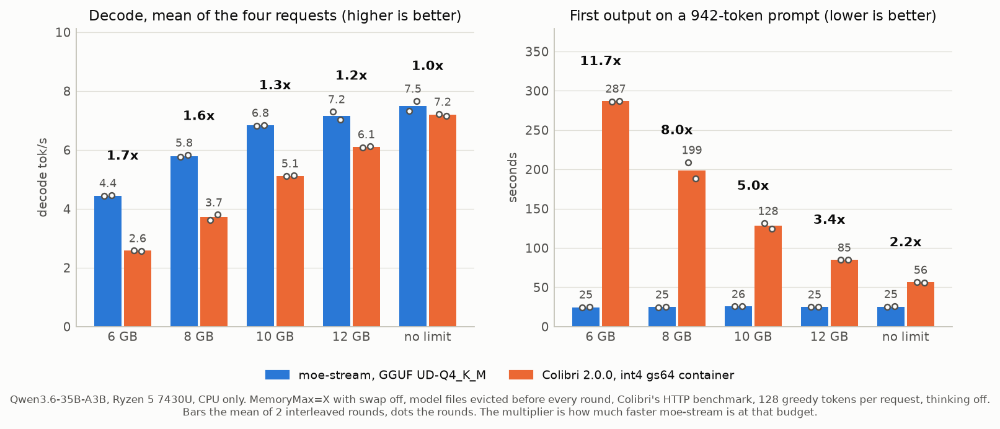

# Notes

## What Edge0 actually is

Three techniques, published Apache-2.0, MLX/Apple-Silicon only
(https://github.com/Edge0-AI/Edge0, docs/architecture.md):

1. **SSD expert offload** — MoE expert weights are mmapped and read on demand;
   attention/norms/embeddings/router stay resident. Peak RAM ~2.9 GB for the
   35B model, ~1 GB for the 8B.
2. **Prerouter** — a small trained network that predicts which experts the
   *next* layer will select, so their weights can be fetched before the real
   router runs. (Idea: "Pre-gated MoE", Hwang et al. 2023.)
3. **Recover-LoRA** — aggressive int4 quantisation, then LoRA adapters
   distilled to recover the lost quality. Adapters stay unmerged.

Models: edge0-35b (Qwen3.6-35B-A3B, 40 layers, 256 experts, K=4, ~23 GB int4)
and edge0-8b (Ling 3.0 tiny hybrid, 24 layers, 128 experts, K=8, ~4.5 GB).

(1) is systems code. (2) and (3) are *trained artifacts* — they need a GPU to
produce for any new model. The runtime must work without them (fallback
heuristics, standard quants) and use them when available.

## Prior art on x86

- **llama.cpp** mmaps GGUF; for MoE only touched experts page in. The OS page
  cache is an LRU that can only react to misses. Windows/CPU/Vulkan/SYCL/CUDA.
  *This is the baseline to beat.*
- **mistral.rs**, **candle** — Rust inference; MoE, GGUF, Windows.
- **ktransformers** — CPU/GPU hybrid expert offload for DeepSeek-class MoE.
- **PowerInfer-2** (SJTU 2024) — neuron-level sparsity streamed from phone flash.
- **"LLM in a flash"** (Apple 2023) — windowing + row-column bundling for
  flash-resident weights.
- **Pre-gated MoE** (2023), **MoE-Infinity**, **Fiddler**, **ExpertFlow**,
  **HOBBIT** — expert prefetch / caching / offload papers.
- **Colibri** (2026) — pure-C engine: dense weights in RAM, routed experts
  streamed from disk through a per-layer cache, its own int4 containers,
  optional Vulkan and CUDA tiers. It predates moe-stream but was not an
  inspiration for it: I only came across it in October 2026, after the design
  here was in place. Compared in Results 18.

## Thesis

The page cache cannot prefetch layer L+1's experts while layer L computes,
because nothing has told it which experts will be selected. A predictor can.
If prediction is good enough and NVMe bandwidth is the bottleneck, explicit
prefetch + an explicit expert cache should beat plain mmap under memory
pressure. It might not beat it by much — measure first.

Things a new runtime could own that llama.cpp does not:
- **Expert-bundled layout.** GGUF stores `ffn_up_exps`, `ffn_gate_exps`,
  `ffn_down_exps` as three stacked tensors; one expert = three scattered reads.
  Bundling an expert's three matrices contiguously = one ~2–3 MB read at near
  sequential NVMe speed.
- **Explicit expert cache** with a RAM budget, LRU + pinned hot experts
  (expert popularity is heavily skewed), instead of trusting the page cache.
- **Prefetch scheduler** driven by a prerouter, with a cheap fallback
  (recent-history / previous-layer experts) so it works on any MoE.

## Back-of-envelope for the reference machine

Qwen3-30B-A3B-class at ~4.5 bpw: 48 layers x 8 active experts x ~2.6 MB
= ~1 GB of expert bytes per token if *everything* misses. At ~3 GB/s NVMe that
is a ~3 tok/s floor with zero caching. With a 6–8 GB expert cache and realistic
hit rates the I/O ceiling is 10–15 tok/s; CPU compute on 3B active params on
an i5-1334U is ~8–12 tok/s. Target: **~6–10 tok/s on a 30B-class MoE with 16 GB
and no GPU.**

## Measurement plan (phase 1)

Subjects:
- `OLMoE-1B-7B-0924-Instruct-Q4_K_M.gguf` (4.2 GB; 16 layers, 64 experts,
  top-8). Fits in RAM — control subject. Memory pressure is simulated with
  `bench/ram-eater.py` so we can sweep "fraction of model resident".
- `Qwen3.6-35B-A3B` (Edge0's base; ~22 GB Q4_K_M) — the real target, later.

Curves to produce with plain llama.cpp + mmap:
- tok/s (tg128) vs. threads — pick the best thread count for this hybrid CPU.
- tok/s vs. resident fraction (100%, 75%, 50%, 25%) via ram-eater.
- disk bytes read per generated token at each pressure level.

Cold vs warm: `bench/purge-standby.ps1` empties the standby list (needs UAC).

## What upstream llama.cpp already has (commit 972d231, 2026-09-17)

- `--load-mode auto|none|mmap|mlock|mmap+mlock|dio` (`-lm`). `dio` = direct I/O.
- `--lazy-mode auto|on|off` (`-lzm`) + a `TENSOR_READ_LAZY` flag in
  `src/llama-model-loader.h`. A lazy tensor stays in the mmap, is excluded from
  the load-time `PrefetchVirtualMemory` / `MADV_WILLNEED`, gets `MADV_RANDOM`
  on POSIX, is forced onto the host CPU buffer regardless of offload settings,
  and its rows fault in on demand. Today only the giant per-layer-embedding
  tables use it (`src/models/gemma4.cpp`, `src/models/qwen4exp.cpp`); the MoE
  expert tensors `ffn_{up,gate,down}_exps` do **not**. Still page-cache driven:
  no explicit cache, no prediction.
- `cb_eval` (`ggml_backend_sched_eval_callback`) — a per-node callback during
  graph execution (used by `llama-eval-callback`, imatrix). Node names carry the
  layer index (e.g. `ffn_moe_topk-12`). This is our hook point.
- Each expert's matrix is a contiguous slice of its stacked tensor
  (`[n_embd, n_ff, n_expert]`, expert outermost) -> one expert = three
  contiguous byte ranges (up, gate, down). Prefetchable by range.

## Spike plan (refined)

0. **Mark experts lazy.** Apply `TENSOR_READ_LAZY` to `ffn_*_exps` (a small
   patch). Stops the loader from trying to prefetch 22 GB into 8 GB at start.
1. **Instrumentation only, no I/O changes.** Via `cb_eval`, log per token and
   per layer: the router's top-k expert ids, and the hidden state entering the
   FFN. Offline (Python) compute:
   - expert popularity skew per layer (how concentrated is the working set?)
   - temporal reuse: P(expert used at layer L for token t | used at t-1)
   - **stale-router prediction accuracy**: apply layer L+1's router weights to
     the hidden state *entering* layer L's FFN (the residual stream changes
     little across one FFN) and measure top-k overlap with the real choice at
     L+1. Also L+2, L+3. This is a zero-training prerouter. If overlap is high,
     prefetch has headroom; if not, we need Edge0-style trained predictors.
2. **Baseline curves** with plain mmap: tok/s and disk MB/token vs. available
   RAM (`bench/sweep-pressure.ps1`), lazy on/off, load-mode mmap vs dio.
3. **Prefetch.** In the `cb_eval` hook after the FFN input of layer L is ready:
   run the stale router for L+1..L+k on it, `PrefetchVirtualMemory` the predicted
   experts' three byte ranges. Measure against (2).

Bound on the upside: prefetch hides latency, not bandwidth. Per token speedup
<= (compute + io) / max(compute, io). At an 80% cache hit rate on a 30B-A3B
(io ~66 ms, compute ~100 ms on this CPU) that is at most ~1.7x; at 0% hits it
is ~1.3x. The cache hit rate (RAM budget x expert-popularity skew x policy)
dominates. Prefetch is the second-order win; cache policy and layout are the
first-order ones.

## Results 1 — OLMoE-1B-7B Q4_K_M, warm, CPU only (2026-09-18)

`llama-bench`, pp512 / tg128, 3 reps, model fully resident:

| threads | pp512 tok/s | tg128 tok/s |
|---|---|---|
| 4 | 39.4 | 14.9 |
| 6 | 44.8 | 20.1 |
| 8 | 49.4 | 20.1 |
| 10 | **55.3** | **22.4** |
| 12 | 56.9 | 20.4 |

Generation saturates at ~20-22 tok/s from 6 threads: memory-bandwidth bound
(~1.3B active params at Q4 ~ 0.8 GB/token -> ~18 GB/s effective on DDR4-3200).
Prompt processing scales with threads. => during decode ~4 cores are idle:
that is free CPU for a prefetch scheduler.

## Results 2 — routing trace, OLMoE, 256 sampled decode tokens (temp 0.7)

`llama-moe-trace` + `bench/analyze-trace.py` (`bench/results/trace-olmoe-256.*`).

**Expert popularity is nearly flat.** Covering 80% of selections needs 38 of
64 experts on average; 95% needs 52; all 64 are used within 256 tokens. OLMoE
is trained with load balancing and it shows. Consequence: a cache holding a
fraction f of the experts hits ~f of the time. No small "hot set" to pin.

**Temporal reuse is low.** Consecutive tokens share only 31% of their experts
at the same layer (range 23-40%). "Same as last token" is a weak predictor.

**Stale-router prediction is strong.** Apply layer L+d's norm + router to the
residual entering layer L's FFN, compare with what L+d really picked:

| lookahead d | exact top-8 hit | recall if 16 prefetched | recall if 32 prefetched |
|---|---|---|---|
| 1 | 0.84 | 0.97 | 0.99 |
| 2 | 0.79 | 0.94 | 0.99 |
| 3 | 0.74 | 0.91 | 0.98 |
| 4 | 0.69 | 0.87 | 0.97 |

A zero-training predictor gives a 2-3 layer lookahead window with 90%+ recall.
Edge0's trained prerouter is not required to get most of the benefit.
Fetching 2k instead of k buys recall with 2x bytes — right call when latency
bound, wrong call when bandwidth bound; make it adaptive (fetch top-k plus any
expert within a score margin of the k-th).

**What this means.** With flat popularity, hit rate ~ resident fraction, so a
model 3x bigger than RAM reads ~2/3 of its per-token expert bytes from NVMe
no matter how clever the cache. The levers, in order:
1. bytes per expert (quantisation; Edge0's Recover-LoRA exists to make lower
   bits acceptable),
2. NVMe bandwidth actually achieved (layout: one contiguous read per expert),
3. hiding latency under compute (predictive prefetch, now shown feasible),
4. cache policy (small effect when popularity is flat).

## Results 3 — memory-pressure curve, OLMoE Q4_K_M (3.9 GB), t=10, mmap

`bench/sweep-pressure.ps1`, pp256 / tg64, 2 reps (`bench/results/summary-v1.csv`):

| available RAM target | pp256 tok/s | tg64 tok/s | disk read during run | run time |
|---|---|---|---|---|
| 6 GB (model fits) | 50.9 | 18.6 | 1.1 GB | 30 s |
| 3 GB | 49.5 | 19.1 | 6.9 GB | 62 s |
| 2 GB | 21.5 | 8.5 | 16.2 GB | 111 s |
| 1.5 GB | 15.4 | 3.65 | 23.4 GB | 163 s |

Caveats: Windows answers pressure by paging *other* processes to the pagefile
first (available rose 3.0 -> 5.2 GB during the 3 GB run), so "available" is a
loose proxy for how much of the model was resident. The wrapper now samples
the benchmark's working set, which measures it directly.

Effective disk throughput of the page-fault path: each pp256 pass at 1.5 GB
must touch >= 1.9 GB of non-resident experts and took 11.6 s longer than warm
-> **~150 MB/s**, on a drive that does 1.2-1.5 GB/s for expert-sized reads.

## Results 4 — what the NVMe can do (`bench/disk-bench.py`, unbuffered)

Samsung BM9C1 512 GB (DRAM-less PCIe 4 OEM drive), 1 GB per test:

| pattern | MB/s | ms/request |
|---|---|---|
| sequential 8 MB QD1 | 1561 | 5.4 |
| random 2 MB QD1 | 1194 | 1.8 |
| random 2 MB QD4 | 1461 | 5.7 |
| random 2 MB QD8 | 1039 | 16.1 |
| random 256 KB QD1 / QD8 | 363 / 770 | 0.7 / 2.7 |
| random 64 KB QD1 / QD8 | 241 / 441 | 0.3 / 1.2 |
| random 4 KB QD1 / QD8 | 24 / 150 | 0.17 / 0.22 |

**The headline.** Expert-sized random reads run at ~80-95% of sequential
bandwidth, QD 2-4 is enough. Demand paging of the mmap runs at ~150 MB/s
(consistent with 4-64 KB clustered faults at low queue depth). That is a
**~10x gap** on this laptop, and the ratio is worse on faster desktop NVMe
drives, whose small-random-read weakness is the same. This is a much larger
lever than latency hiding: it means the I/O floor for a model 3x bigger than
RAM is not "bytes / 150 MB/s" but "bytes / ~1.3 GB/s".

Revised per-token estimate for Qwen3.6-35B-A3B (8 of 256 experts, 1.8 MB each
at Q4, 40 layers => 570 MB/token all-miss; ~36% resident => ~365 MB/token):
- page cache as-is: 365 MB / 0.15 GB/s = 2.4 s/token  (**~0.4 tok/s**)
- expert-sized prefetch: 365 MB / 1.3 GB/s = 0.28 s/token, overlapped with
  ~0.1 s compute  (**~3.5 tok/s**), ~9x
- plus K=4 routing like Edge0: ~180 MB/token -> ~0.14 s  (**~6-7 tok/s**)
- plus 3-bit experts: another ~25%.
So "usable" is plausible on this laptop but it takes all three levers; the
first one (big reads) is the one nobody gets for free from the OS.

Lowest-effort path to capture it inside llama.cpp: predict experts via the
stale router (Results 2), then `PrefetchVirtualMemory` the predicted experts'
three byte ranges; the kernel issues large efficient reads for the ranges.
No custom I/O path needed for the spike.

## Results 5 — the spike: predictive prefetch inside llama.cpp (2026-09-18)

Built: `patches/0001-lazy-experts.patch` (with `-lzm on`, `*_exps.weight`
tensors are lazy: no load-time prefetch) and `tools/moe-run` (stale-router
prediction in a `cb_eval` hook at `ffn_inp-L`, `PrefetchVirtualMemory` of the
predicted experts' three ranges for layers L+1..L+depth, on a worker thread,
skipping experts whose pages are already in the working set via
`QueryWorkingSetEx`). Driver: `bench/ab-prefetch.ps1`; rows in
`bench/results/ab.csv`. OLMoE Q4_K_M, t=10, 48 greedy tokens, same prompt.

In-process prediction matches the offline trace exactly (0.847 exact top-8 at
depth 1; 0.878 union of depths 1-2; 0.98 at width 16).

What happened, in order:

1. Synchronous prefetch (v1): faults/token fell 23k -> 12k at depth 3, but
   `PrefetchVirtualMemory` blocked the compute thread for 170-330 ms/token —
   it walks every page of every range, ~0.16 ms/MB even when resident. Net:
   2.4 -> 3.0 tok/s at best.
2. Worker thread + residency filter (v2/v3): 2.4-2.6 -> 4.5-4.8 tok/s at
   "2 GB available"... but sequential runs drift: Windows keeps paging other
   processes out, so each later run has more effective cache.
3. More threads / touching pages to pre-map them (v3): both *worse*
   (3.4 and 2.7 tok/s; soft faults 39-47k/token). The compute threads' faults,
   the prefetch call and the toucher all contend for the process's memory-
   manager locks, and growing the working set makes the OS trim harder.
4. Interleaved A/B/A/B (v4), the honest numbers:

| available | base | prefetch d2 | base | prefetch d2 |
|---|---|---|---|---|
| 2 GB | 2.01 | 2.98 | 3.06 | 3.12 |
| 1.5 GB | 1.37 | 1.28 | 1.14 | 1.41 |

**~0-25% at moderate pressure, nothing at severe pressure.** Width 16 is a
clear loss (2x bytes in an I/O-bound regime). Depth beyond 2 does not help.

Why (all measured):
- `PrefetchVirtualMemory` moves ~0.6 GB/s, single-threaded, and cannot be
  parallelised (lock contention with the faulting compute threads).
- Under pressure the compute threads take ~48k hard faults/token = one per
  4 KB page, no clustering, each a synchronous I/O wait. That is the ~150 MB/s
  path from Results 3/4, and prefetch does not change how those pages arrive.
- Prefetched pages are evicted before use when memory is scarce: the OS cache
  policy is not ours to set.

**Conclusion of the spike.** Prediction works (88-98% recall, zero training).
The page cache is the wrong engine: it cannot be steered into large parallel
reads, it charges a fault per page, and it evicts what we prefetch. The
measured 5-8x gap between demand paging (150-250 MB/s) and explicit
expert-sized reads (1.2-1.5 GB/s, Results 4) can only be collected by owning
the I/O path: an expert cache in *our* memory (not file-backed), filled by
unbuffered overlapped `ReadFile` at 2 MB granularity, QD 2-4, and a
`mul_mat_id` that gathers experts through a slot table instead of a fixed
stride. That is the runtime design, and it is now justified by measurement.

Expected on this laptop once the I/O is owned (OLMoE, 50% resident):
~220 MB/token / 1.2 GB/s = 180 ms, overlapped with ~50 ms compute -> ~5 tok/s
vs 1.3 today (4x); at 80% resident ~10 tok/s vs 3 (3x). For Qwen3.6-35B-A3B
at 36% resident: 365 MB/token -> ~0.3 s -> ~3 tok/s at K=8, ~6 tok/s at K=4,
vs well under 1 tok/s with the page cache.

## Next step options

A. **Explicit expert cache inside llama.cpp** (C++, ~1-2 days): per-layer
   cache tensor `[n_embd, n_ff, C]` in anonymous memory + an I32 slot table;
   `build_moe_ffn` gains `slot_ids = get_rows(slot_table, selected_experts)`
   and runs `mul_mat_id` on the cache tensor; the `ffn_moe_topk-L` hook
   resolves misses (wait for in-flight prefetch, else synchronous 2 MB reads)
   and updates the slot table before the graph continues; prefetch as today
   but into slots via overlapped `ReadFile`. Gives the definitive number and
   is the reference implementation for the Rust runtime.
B. Skip to the Rust runtime with the design above.
C. First download Qwen3.6-35B-A3B (22 GB) and reproduce the baseline curve at
   real scale (K=8 vs K=4 quality check with llama-perplexity).

## Results 6 — explicit expert cache inside llama.cpp (2026-09-18)

Built (option A):
- `patches/0002-expert-cache-hook.patch` — `llama_expert_cache_register(orig, cache, max_tokens)`
  + a registry in `llama-graph.cpp`. `build_moe_ffn` looks the layer's expert
  tensors up; when cache tensors are registered and the batch is small enough,
  it emits `ffn_moe_slot_ids-<il>` (a `ggml_dup` of the selected expert ids)
  and runs the three `mul_mat_id`s on the cache tensors addressed by it.
  Biases/LoRA keep the real ids; prefill (n_tokens > max_tokens) uses the mmap.
- `tools/moe-run/expert_cache.{h,cpp}` — per-layer slot cache in anonymous,
  `VirtualLock`ed memory (a ggml CPU buffer of `[ne0, ne1, C]` tensors of the
  original quant type), LRU eviction with the current token's slots pinned,
  an I/O thread pool doing unbuffered `ReadFile` of each expert's three chunks
  (offsets from the GGUF metadata via `gguf.h`), misses queued ahead of
  prefetches. The `ffn_moe_slot_ids` hook resolves ids -> slots (loading
  misses, waiting for in-flight prefetches) and rewrites the tensor in place.
  Prefetch = same stale-router prediction as before, now landing in slots.
- `--cache-slots C --io-threads N [--cache-max-tokens T] [--no-lock]`,
  `--io-bench N` (in-process raw read test).

**Correctness:** greedy token hash identical on the mmap path and on every
cache configuration (`2247ad9cb26432b9` for the reference prompt).

**Bugs found on the way:** the per-layer prediction set was only cleared by
the stats hook, so without `--stats` nothing was prefetched after token 1
(now keyed by token); misses were queued behind prefetches (now front).
Threads/touching in the page-cache path made things worse (MM lock
contention); the `max` macro from windows.h.

**The drive throttles.** The Samsung BM9C1 (DRAM-less, laptop) sustains
1.2-1.4 GB/s for 2 MB reads when cool and drops to 600-750 MB/s after a few
minutes of sustained random reads (measured repeatedly in both Python and
C++: same code, same file, 2x swings within minutes). Sustained ~650 MB/s is
the realistic ceiling here; every A/B below is interleaved so both sides see
the same drive state.

**Equal-RAM-budget A/B** (`bench/ab-prefetch.ps1`, `-lm mmap+mlock -lzm on`,
48 greedy tokens, ram-eater leaving X GB available before each run; the
explicit cache locks its slots inside that budget):

| budget | page cache | explicit cache | faults/token | |
|---|---|---|---|---|
| 2.5 GB | 1.89 tok/s | **2.92 / 2.98** (32 slots, 1.86 GB) | 24.9k -> ~850 | 1.56x |
| 1.5 GB | 1.07 / 1.17 | **1.51 / 1.68** (16 slots, 0.93 GB) | 47-50k -> ~900 | 1.4x |

(One baseline run hit 28.6 tok/s: Windows had paged other apps out and the
whole model fit — the "available" knob is only approximately a budget, and it
favours the page-cache side, whose standby list can grow into memory freed
from other processes while our locked cache cannot.)

Per token at 32 slots, from the two logged runs (`ab-20260918-013008` and
`ab-20260918-013149`): 97.2 and 97.8 hits, 22.7 and 22.2 late hits, 8.2 misses,
41.9 prefetched, 39.4 evictions, 191.3 MB read, main thread blocked 283 and
273 ms. Each of the two I/O threads moved 291 and 299 MB/s, so the drive was
busy for roughly 330 ms of a 343 ms token. The cache path is purely
bandwidth-bound and page faults are gone.

(An earlier draft of this paragraph quoted 108 hits, 11 late hits, 185 MB and
~290 ms. Those were from an unlogged run during development; the figures above
are the ones in `bench/results/`, and they are what the article and the charts
use.)

**What that means.** With the I/O owned, tok/s = bytes per token / sustained
bandwidth, overlapped with compute. The remaining levers are all about bytes
and bandwidth, none about faults:
1. bytes per expert: Q4_K_M keeps `down_exps` at Q6_K (1.7 MB vs 1.2 MB);
   a uniform Q4/IQ4 quant is ~15% fewer bytes, Q3 ~30% (quality: measure).
2. K: `--override-kv olmoe.expert_used_count=int:4` halves the bytes with no
   code change — Edge0's K=4 trick; needs a perplexity check.
3. the drive: on a desktop NVMe sustaining 3+ GB/s the same code is ~10 tok/s
   at 50% residency; here a cooling pad would literally be a 2x speedup.
4. prefetch waste (12% wrong predictions) and eviction policy: small.
5. an expert-bundled layout (one 3.8 MB read instead of three 1.2-1.7 MB
   reads per expert) — larger requests are worth ~20-30% at QD1-2 on this
   drive per `disk-bench.py`.

## Results 7 — is K=4 free? Perplexity vs. active experts (2026-09-18)

`bench/ppl-k-sweep.ps1` / `llama-perplexity --override-kv olmoe.expert_used_count=int:K`,
OLMoE-1B-7B-Instruct Q4_K_M, ctx 512. Two corpora: `bench/corpus.txt` (git
documentation prose, built by `bench/make-corpus.py`, 40 chunks) and
wikitext-2-raw test (`C:\models\eval`, 80 chunks) for comparability with
published numbers.

| K | expert bytes/token | PPL git-doc | PPL wikitext-2 |
|---|---|---|---|
| 8 (native) | 100% | 4.85 +/- 0.11 | 11.44 +/- 0.23 |
| 6 | 75% | 5.44 +/- 0.14 (+12%) | 12.50 +/- 0.26 (+9%) |
| 4 | 50% | 9.08 +/- 0.26 (+87%) | 16.17 +/- 0.36 (+41%) |
| 2 | 25% | 48.5 +/- 1.9 (10x) | — |

**No, K=4 is not free** on OLMoE: +41% perplexity on wikitext-2, +87% on
technical prose. K=6 costs 9-12% for 25% fewer bytes — in the same regime as dropping one quant level,
and a legitimate knob. K=2 is dead. The curve is convex: each expert removed
hurts more than the last.

This is the concrete case for Edge0's Recover-LoRA: their K=4 on Qwen3.6 is
only viable because adapters were distilled against the K=4 routing. Raw, the
2x I/O saving from K=4 buys a much worse model. Caveats: OLMoE (64 small
experts, no shared expert) may be more K-sensitive than Qwen3.6-35B-A3B
(256 experts, top-8 + a shared expert that carries a baseline) — the same
sweep costs nothing to run on Qwen3.6 once it is downloaded, and should be.

Ranking of bytes-per-token levers by quality cost, so far:
1. lower-bit quantisation (typically +3-10% PPL for 15-30% fewer bytes),
2. K=6 (+12% for -25%),
3. K=4 (+87% for -50%) — only with recovery training.

## Results 8 — expert-bundled layout (2026-10-07)

Built (the layout lever from Results 6, item 5):

- `tools/moe-run/expert_bundle.h` — the sidecar format. A GGUF cannot express a
  bundled layout: every tensor there has to be one contiguous blob and bundling
  interleaves bytes from three of them. So the bundled copy lives in a sidecar
  file beside the model; the GGUF is untouched and still loads normally, and
  only the expert cache reads the sidecar. Bundles are 4096-aligned and the last
  one is padded to a full stride, so every read is sector aligned and in bounds.
- `tools/moe-run/moe-bundle.cpp` (`llama-moe-bundle -m model.gguf [--verify]`) —
  writes it. `--verify` compares every expert byte against the GGUF.
- `expert_cache` gained `--experts-file`: one `ReadFile` of the whole bundle per
  expert instead of three. The header is checked against the model (tensor names
  in cache order, bytes per expert, expert count) and rejected rather than
  served if anything disagrees.

OLMoE Q4_K_M: 16 layers x 64 experts = 1024 bundles, stride 3.38-3.89 MiB
(Q4_K_M uses different quant types per layer, so it varies), sidecar 3.63 GiB
next to the 3.92 GiB GGUF. `--verify` passes.

A/B (`bench/ab-layout.ps1`), interleaved split/bundled, 48 greedy tokens,
prefetch depth 2, 2 I/O threads, no memory pinning, 3 rounds each:

| cache | layout | tok/s | requests/token | MB/request | MB/s per I/O thread | main thread wait |
|---|---|---|---|---|---|---|
| 32 slots (1.86 GiB) | split | 6.30 / 6.24 / 6.21 | 150.3 | 1.27 | 649 | 115 ms/token |
| 32 slots | **bundled** | **9.73 / 9.33 / 9.49** | **50.1** | **3.82** | **1031** | **62 ms/token** |
| 16 slots (0.93 GiB) | split | 3.50 / 3.61 / 3.60 | 275.8 | 1.27 | 643 | 229 ms/token |
| 16 slots | **bundled** | **5.71 / 5.76 / 5.79** | **91.9** | **3.81** | **1049** | **127 ms/token** |

**1.52x at 32 slots, 1.61x at 16.** Token hash `3b15dac0721bfcbf` on all twelve
runs, so the layout is bit-exact like the cache itself. Bytes per token are
identical on both sides (191.3 MB at 32 slots, 349.9 MB at 16): the gain is
entirely the drive doing more with the same bytes, 645 -> 1040 MB/s per I/O
thread, which tracks the request-size curve in `disk-bench.json` independently.

More than the 20-30% predicted in Results 6. The guess compared 1.27 MB against
3.8 MB requests at a fixed queue depth; the real pattern is three separate seeks
per expert interleaving across two I/O threads, which costs more than the size
difference alone.

**Why these runs are unpinned.** Both layouts read with `FILE_FLAG_NO_BUFFERING`
and the cache is locked, so neither side depends on the page cache and pinning
changes nothing about what is being compared. It only adds noise, and on this
machine it does not work reliably at these cache sizes:

- The one pinned sequence that completed (2.5 GB available, 32 slots, 4 runs,
  tagged `r8-avail2.5g` in `layout.csv`) read 6.01 split, 4.44 bundled, 2.39
  split, 3.23 bundled, with per-thread throughput falling 632 -> 474 -> 237 ->
  330 MB/s as the drive heated. The thermal drift inside one sequence is larger
  than the effect being measured, so that sequence says nothing either way.
- Every later attempt failed outright. `ram-eater.py` pins whatever is free at
  the time, so on an idle machine it pinned 6.1 to 7.3 GB, and a 2.5 GB budget
  then cannot host the locked cache at all: `failed to allocate buffer of size
  1950351360`. Making the budget a real budget needs cgroup-style limits, which
  is one of the reasons `SETUP.md` argues Linux is the better measurement
  platform.

The unpinned runs are reported as the result because they are the controlled
measurement, not because they are the flattering one.

**Not isolated:** the sidecar is a freshly written file, so some of the gain
could be its physical placement rather than request size. Requests per token
fell exactly 3x and per-request throughput rose in line with the disk benchmark,
which is why I think it is request size, but the two are not separated.

**Harness bugs found on the way.** Both were silent and both predate this
change: (a) the CSV writers formatted with the current culture and then stripped
commas as thousand separators, so on a machine with a decimal comma 6.21 was
written as 621 — they now force `InvariantCulture`; (b) `Start-Process
-ArgumentList` was passing unquoted paths, so any path containing a space (this
repo lives under "AI Engine") broke the `--json` argument and the ram-eater
launch.

## Results 9 — Gemma 4 26B-A4B: the cache on a real target (2026-10-13)

A second machine and the first model that is not a control: **Ryzen 5 7430U** (6C/12T, AVX2, no AVX-VNNI,
so built with `-DGGML_NATIVE=ON` only), 15.4 GB RAM of which ~8 GB is free with nothing loaded, Solidigm
NVMe. `disk-bench-ryzen7430u.json`: 1302-1339 MB/s for 2 MB random reads at QD4-8, 961 MB/s at QD1,
26 MB/s for 4 KB QD1 — the same shape and almost the same numbers as the reference machine, so its
conclusions should carry over.

Model: `gemma-4-26B-A4B-it-UD-IQ3_S.gguf` (unsloth), 10.5 GiB, 30 layers x 128 experts, top-8.
`bench/gguf-experts.py` shows the layout per layer: merged `ffn_gate_up_exps` (IQ2_S, 1240 KiB per
expert) + `ffn_down_exps` (IQ4_NL, 1089 KiB) = **2.33 MiB per expert, 8.9 GiB of the 10.5 are experts**,
plus a per-expert scale `ffn_down_exps.scale`. One decode token touches 30 x 8 x 2.33 = 559 MB of experts.

Built:

- `patches/0003-expert-scale-ids.patch`. `build_lora_mm_id` gets an `ids_e` argument: the per-expert
  scale and LoRA index by real expert ids while the matmul uses slot ids. 0002 instead turned the cache
  off whenever any `*_exps_s` tensor existed, so on Gemma 4 the cache would silently never have run.
- `moe-run` now marks `temp` as user-set. **Harness bug:** a GGUF can carry `general.sampling.temp`
  (Gemma 4: 1.0, top_k 64, top_p 0.95) and the loader applies it over the tool's greedy default, so
  every "greedy" run sampled at temp 1.0 with a random seed and no two hashes matched — including two
  plain mmap runs. OLMoE's GGUF has no such key, so the hashes in Results 6 and 8 stand.
- `bench/chat-prompt.py`: renders a prompt with the model's own chat template. Gemma 4 instruct
  produces garbage on a bare "The capital of France is" in every build including upstream b11580, so
  hash checks need templated prompts (`bench/prompts/`).

**Bit-exact:** token hash `07790982544d57b8` for mmap and for 32, 64 and 96 slots (256 greedy tokens,
story prompt, `-c 16384`, `-t 6`, `-lzm on`, 4 I/O threads, no prefetch, unpinned):

| | experts locked | decode tok/s | misses/token (of 240) | read MB/token | main thread wait |
|---|---|---|---|---|---|
| mmap | - | **6.65** | - | - | - |
| 32 slots | 2.2 GiB | 3.89 | 42.6 (18%) | 102 | 116 ms/token |
| **64 slots** | **4.4 GiB** | **5.79** | **10.3 (4.3%)** | 25 | 31 ms/token |
| 96 slots | 6.6 GiB | 5.60 | 8.8 | 21 | 26 ms/token |

**Gemma 4 has a hot set.** Half the slots catch 96% of lookups, where OLMoE needed 38 of 64 experts to
cover 80% (Results 2). Cache policy matters on this model; on OLMoE it did not.

Single run per row, so read the 64/96 difference as noise; the 32 -> 64 step is not. The mmap row is the
best case for mmap: nothing else running and the model nearly fits.

## Results 10 — layer-streamed prefill, and the cache inside llama-server (2026-10-13)

The first use of the cache outside `moe-run`: a journal grader (`llama-server`, JSON-schema output,
735-token prompt, ~250 tokens out). `patches/0004-server-expert-cache.patch` adds the cache to the
server through environment variables (`MOE_CACHE_SLOTS`, `MOE_IO_THREADS`, `MOE_CACHE_MAX_TOKENS`,
`MOE_STREAM_PREFILL`, `MOE_EXPERTS_FILE`), so `common/arg.cpp` stays untouched.

With only the decode cache, grading got **worse**: 134 s against 76 s, 11.7 GB peak working set, 31 MB
of RAM left. Prompt processing (n_tokens > `max_tokens`) still ran on the mmap, and a 512-token batch
touches nearly every expert, so the OS paged all 8.9 GiB of experts in on top of the 4.4 GiB locked cache.

Built:

- **Layer streaming** (`patches/0005-expert-stream-prefill.patch` + `expert_cache` stream mode,
  `moe-run --stream-prefill`). Each expert tensor gets a second registration, a *stream* view with all
  128 experts, used for batches above `max_tokens`. Two buffers of 344 MiB hold one layer each; MoE layer
  k lives in buffer k % 2. When layer k's `ffn_moe_slot_ids` callback fires, the runtime waits for layer k
  and queues layer k+1 into the other buffer, whose previous layer's matmuls ran before this callback.
  Layers load as two big sequential reads split into 4 MiB requests over the I/O threads, from the GGUF
  even when a sidecar is in use. After the last layer it loads layer 0 for the next batch.
- **`max_tokens` = slots / experts-per-token** when not given (8 at 64 slots), and clamped to it always:
  a batch that needs more distinct experts in a layer than there are slots would wait forever in
  `on_slot_ids`. Batches of 2-8 tokens therefore use the slots instead of streaming 8.9 GiB.
- **Seeding:** when a layer is in its stream buffer, the experts the batch used most are copied into
  the slots (memcpy, no I/O), so decode does not start from an empty cache.
- **Dense prefetch:** with experts streamed, the non-expert weights (569 tensors, 2.5 GiB) are what the
  first prompt faults in; one `PrefetchVirtualMemory` call at init (0.18 s, asynchronous).

**Bit-exact:** the 735-token grading prompt (two ubatches) gives `c3e9a15388bb95a5` on mmap, with
streaming, with seeding, and with prefetch depth 1 and 2. The story run in Results 9 also matches with
streaming on.

`moe-run`, grading prompt, 192 tokens out, 64 slots:

| | prefill tok/s | decode tok/s | misses/token | wait/token | graph waited for streaming |
|---|---|---|---|---|---|
| mmap | 19.8 | **6.70** | - | - | - |
| stream | 20.9 | 4.85 | 21.8 | 61 ms | 1.98 s of 35 s |
| stream + seeding + dense prefetch | **22.8** | 5.10 | 15.2 | 46 ms | 2.10 s of 32 s |

Streaming hides almost all of its I/O behind compute: 18.7 GB read for two ubatches, 2 s of waiting.
Prefill is now compute-bound. Decode is slower than mmap for a short answer because the cache starts
cold for what the *answer* needs; seeding takes misses from 21.8 to 15.2 (1920 experts seeded in 0.55 s),
but an English JSON answer uses different experts than a Serbian entry plus English instructions.

On the story prompt (34-token prefill, 256 tokens out) streaming made decode *faster*, 6.69 tok/s with
5 page faults/token against 5.79 with prefill on the mmap: the cache no longer competes with 8.9 GiB of
paged-in experts.

**The stale-router prefetcher does not pay on Gemma 4.** Gemma 4 routes on `attn_out`, not `ffn_inp`,
through `rms_norm(x) / sqrt(n_embd) * ffn_gate_inp_s`; the prefetcher now does the same for this arch.

| prefetch | prediction hit rate | decode tok/s | read MB/token | evictions/token |
|---|---|---|---|---|
| off | - | **5.10** | 37 | 15 |
| depth 1, width 8 | 0.656 | 4.58 | 78 | 32 |
| depth 2, width 8 | 0.702 | 4.11 | 118 | 49 |

66-70% against OLMoE's 84%, and with 64 of 128 slots every wrong guess evicts an expert that was going
to be used. The routing math also costs 12-23 ms/token on one thread. Off by default.

**In the server** (`bench/journal-ab.ps1`, same entry graded by each config, `journal-ab.csv`):

| | wall s | prompt tok/s | decode tok/s | peak working set | lowest available RAM | grades |
|---|---|---|---|---|---|---|
| mmap | 101 / 86 / 128 | 16.3 / 26.4 / 27.1 | 7.3 / 6.6 / 6.7 | 10.1-10.6 GB | **13 / 76 / 46 MB** | 5/4/5/5 x3 |
| moe-stream, 64 slots | 102 / 114 / 105 | 19.6 / 20.1 / 19.5 | 4.8 / 4.8 / 4.6 | 9.3-9.4 GB | **805 / 835 / 962 MB** | 5/4/5/5 x3 |

**Same wall time; the difference is headroom.** mmap takes the machine down to tens of MB free, so
anything else running pages; moe-stream leaves ~0.9 GB free and its prompt speed does not depend on
what the OS cache still holds (mmap's 16 -> 27 tok/s across rounds is the previous run's pages). Peak is
9.3 GB rather than the ~7 GB I estimated because the non-expert weights are 2.5 GiB, not 1.6.

This is not a speed win at this size because the model nearly fits. It is the setup for what does not:
the same code runs a 13 GiB QAT quant or a 20 GiB Qwen3.5-35B-A3B on this machine.

Caveats: the first moe-stream round ran before seeding and dense prefetch were added (rows 2-3 have
them). Three rounds, one machine, unpinned. The server prints no cache counters yet, so server-side
miss rates are inferred from the matching `moe-run` runs.

## Results 11 — Linux port, and the model under real memory budgets (2026-10-13)

Same laptop as Results 9-10 (Ryzen 5 7430U, 15.4 GB, Solidigm NVMe), booted into Arch instead of
Windows: Linux 7.2, GCC, btrfs, model copied onto the Linux partition. `expert_cache.cpp` and
`moe-run.cpp` now build on both systems (SETUP.md, Linux): `O_DIRECT` + `pread`, `posix_memalign`,
`mlock`, `madvise(WILLNEED)`, `mincore`, and `getrusage` so major faults are counted on their own.
`mlock` fails at Arch's 8 MiB `ulimit -l`; it warns and goes on, as on Windows.

**Bit-exact within the Linux build.** Story prompt, 256 tokens, `-t 6 -c 16384 -lzm on`: mmap, 32, 64
and 96 slots, and 64 slots + `--stream-prefill` all give `090643b6af8e29c9` (MSVC gave `07790982544d57b8`;
GCC rounds differently, as expected). All 15 budget runs below give `aa7be0807a9ce7a9` (128 tokens).

| story, 256 tokens | Windows decode tok/s | Linux decode tok/s | Linux misses/token | Linux major faults/token |
|---|---|---|---|---|
| mmap, warm | 6.65 | 6.77, then **8.73** | - | 2443, then 972 |
| 32 slots | - | 5.78 | 42.2 | 0.3 |
| 64 slots | 5.79 | 9.11 | 10.2 | 1.0 |
| 96 slots | - | 9.03 | 8.6 | 1.0 |
| 64 slots + stream prefill | 6.69 | **9.76** | 6.1 | 0.0 |

Linux is faster on everything, mmap included (+31% warm), and the cache gains more (+46%). The miss
counts are close to Windows' (64 slots: ~10/token both), so the gap is not I/O. Most likely the compiler
(GCC vs MSVC on the ggml CPU kernels) plus less background load; not isolated. I/O per thread: 520-800
MB/s for 1.2 MB `O_DIRECT` reads, with 4 threads.

**Memory budgets** (`bench/mem-budget.sh`): `systemd-run --user --scope -p MemoryMax=X -p
MemorySwapMax=0`, no root. Every run starts cold for the model file (`bench/evict-file.py`,
`posix_fadvise(DONTNEED)`). Story prompt (34 tokens), 128 tokens out, `--io-threads 4`. Page cache counts
against `MemoryMax`, so the mmap run gets exactly X for weights + KV + everything else.

| budget | mmap decode | mmap wall | 32 slots + stream | wall | 64 slots + stream | wall |
|---|---|---|---|---|---|---|
| 6 GB | 1.97 (18063 majflt/tok) | 91 s* | **5.68** (0) | 30 s* | 0.41 (655 majflt/tok) | 320 s |
| 8 GB | 4.88 (4936) | 52 s | 5.94 (0) | 29 s | **9.58** (0) | 21 s |
| 10 GB | 6.31 (3136) | 46 s | 5.93 | 29 s | **9.44** | 21 s |
| 12 GB | 6.35 (3128) | 46 s | 5.95 | 29 s | **9.56** | 21 s |
| none | 6.35 (3128) | 46 s | 5.94 | 29 s | **9.57** | 21 s |

\* `bc` was missing for the first two runs; process time from the log's elapsed stamps instead.
Wall includes model load. Prefill: mmap 1.4 tok/s with ~1.04 M major faults, streaming 6.2 tok/s with
~380, at every budget.

What it shows:

- **At 8 GB, moe-stream is 2x mmap on decode and 2.5x end to end** (21 s vs 52 s), at the same output.
  At 6 GB, 32 slots runs 2.9x mmap and does not fault at all. moe-stream's speed does not move from
  8 GB to unlimited: it only uses what it allocated.
- **mmap above 10 GB is limited by the cold start, not the budget.** 10, 12 GB and unlimited are
  identical (6.3 tok/s, ~3.1k major faults/token): the first touch of each expert is a 4 KiB-granular
  fault, 128 tokens is too short to warm up, and prefill pages in 1 M faults at 1.4 tok/s. Warm, mmap
  reaches 8.7 tok/s (table above), still below 64 slots + stream at 9.6-9.8.
- **Too many slots is worse than mmap.** 64 slots + stream at 6 GB leaves under 1 GB for the 2.5 GiB of
  non-expert weights and the KV cache; those thrash instead (655 major + 33k minor faults/token, 0.41
  tok/s). The budget rule from Results 10 holds: slots x 69 MiB + 688 MiB stream + 2.5 GiB dense + KV.
  A `--cache-slots auto` that sizes from `memory.max` would avoid the cliff.

Caveats: one prompt, short output, one run per cell (the warm mmap runs show run-to-run drift of 30%).
Desktop session running (browser, terminal, ~4 GB). mmap's cold numbers include the model's first read
from disk, which a long-running server pays once; the warm row is the fair decode comparison.

## Results 12 — Qwen3.6-35B-A3B: a model twice the size of RAM (2026-10-13)

`unsloth/Qwen3.6-35B-A3B-GGUF`, `UD-Q4_K_M`, 20.6 GiB (SHA256 checked) on the 15.4 GB laptop: 40 MoE
layers, 256 experts, top-8, three expert tensors (Q4_K up/gate 576 KiB, Q5_K down 704 KiB; 1.81 MiB per
expert, 72.5 MiB per slot across layers), 18.1 GiB of experts and ~2.5 GiB of everything else. Arch
`qwen35moe` (linear-attention layers included) runs at the pin with no new llama.cpp patch.

One fix in `moe-run`: the prefetcher read `ffn_norm` for every MoE layer, which Qwen 3.5/3.6 does not
have, and crashed at init even with prefetch off. It now routes on `rms_norm(attn_residual) *
attn_post_norm` for this arch (`models/qwen35moe.cpp`), and any architecture without a known router
input gets prefetch disabled with a warning instead of a crash.

Prompt: the same story request rendered with Qwen's template, thinking off
(`bench/prompts/qwen36-story.txt`, 33 tokens). Same harness as Results 11 (`bench/mem-budget.sh`,
`MODEL`/`PROMPT`/`SLOTS`/`TAG`), cold model file every run, 128 tokens out.

**Bit-exact:** mmap, 32, 64 and 96 slots + stream give `cc86c28936a61b2d` at 64 tokens; all 13 budget
runs give `89be017abcab1043` at 128.

| budget | mmap decode | mmap wall | 32 slots + stream | 64 slots + stream | 96 slots + stream |
|---|---|---|---|---|---|
| 6 GB | 0.82 (42752 majflt/tok) | 192 s | **3.42** (97 majflt/tok), 50 s | - | - |
| 8 GB | 1.58 (20454) | 117 s | **4.25** (0), 43 s | - | - |
| 10 GB | 2.42 (11778) | 89 s | 4.24, 43 s | **5.79**, 35 s | - |
| 12 GB | 3.41 (7380) | 74 s | - | 5.60, 35 s | **6.47**, 33 s |
| none | 3.53 (6999) | 72 s | - | 5.80, 35 s | **6.77**, 32 s |

Slot counts per budget are the ones whose total (slots x 72.5 MiB + 996 MiB stream + 2.5 GiB dense +
KV) fits; 32 slots at 6 GB is just over the line, hence 97 major faults/token on the dense weights.

| slots | misses/token | read MB/token | wait ms/token |
|---|---|---|---|
| 32 | 86.7 | ~160 | 124 |
| 64 | 41.6 | ~77 | 64 |
| 96 | 25.8 | 49 | 42 |

What it shows:

- **The case the project is for.** mmap cannot hold this model at any budget on this machine, and it
  degrades with the budget: 3.5 tok/s unlimited down to 0.82 at 6 GB. moe-stream runs it at 3.4-6.8
  tok/s: **4.2x mmap at 6 GB, 2.7x at 8 GB, 2.4x at 10 GB, 1.9x unlimited**, with 0.1 major faults per
  token and the same tokens. End to end (wall, including load and prefill) it is 2.1-3.8x.
- **Slots keep paying here.** Gemma 4 saturated at 64 slots (128 experts); with 256 experts, 96 slots
  still halves the misses of 64, and decode is still I/O-bound at 42 ms/token of waiting. The
  `--cache-slots auto` from Results 11 should take as many slots as the budget allows.
- **Prefill is now I/O-bound.** Streaming reads all 20 GB per prompt (41 layer loads) at ~1.8 GB/s
  aggregate with 4 threads, and the graph waited 7.1 of 11.1 s: 3.0 tok/s against mmap's 1.0, but a
  33-token prompt touches nearly every expert anyway (264 picks per layer over 256 experts). For short
  prompts, a hybrid (slots for experts already cached, stream the rest) would read less.

Caveats as in Results 11: one prompt, one run per cell, short output, desktop session running. Each
expert is still three reads (0.64 MB each); the bundled sidecar would make it one, but needs another
18 GB of disk.

## Results 13 — `--cache-slots auto` (2026-10-13)

Results 11 found the cliff (64 Gemma slots at 6 GB: 0.41 tok/s, against 5.68 for 32) and Results 12 that
Qwen keeps gaining from every slot that fits. Picking the count by hand needs both facts, so the cache now
does it: `--cache-slots auto` in `moe-run`, `MOE_CACHE_SLOTS=auto` in `llama-server` (patch 0004).

slots = (available - non-expert weights - stream buffers - 256 MiB) / bytes per slot, capped at
`n_expert`; fewer than one token's experts (k) refuses to start. *Available* is the smaller of:

- every cgroup v2 level above the process: `memory.max - (memory.current - file)`, so page cache counts
  as reclaimable and what is already allocated (KV, weights touched at load) as used;
- `MemAvailable` less 15% of RAM (Windows: `ullAvailPhys`, same margin).

The margin and the reserve came from four rounds against the same runs:

| version | failure |
|---|---|
| 512 MiB reserve, no system margin | no limit took 125 Qwen slots: the desktop's page cache was counted as free, 10 major faults/token |
| 128 MiB, 10% margin | 111 Qwen slots at 12 GB and unlimited faulted where 106 ran clean; at 8-10 GB some runs faulted, some did not |
| 128 MiB, 15% margin | 100 slots at 12 GB still faulted once: with ~150 MiB of slack, whether the dense weights survive depends on the rest of the system |
| **256 MiB, 15% margin** | below; 29 of 30 runs clean |

Final version, 3 rounds per cell, cold model file each run, same prompts as Results 11/12, 128 tokens:

| budget | Qwen slots | Qwen tok/s (3 runs) | hand-picked best | Gemma slots | Gemma tok/s (3 runs) | hand-picked best |
|---|---|---|---|---|---|---|
| 6 GB | 25 | **3.88** (3.85-3.89) | 3.42 (32) | 27 | 5.13 (5.07-5.14) | **5.68** (32) |
| 8 GB | 53 | **5.32** (5.30-5.32) | 4.25 (32) | 57 | 9.16 (9.15-9.20) | **9.58** (64) |
| 10 GB | 81 | **6.41** (6.41-6.41) | 5.79 (64) | 87 | **10.08** (10.03-10.14) | 9.44 (64) |
| 12 GB | 100 | **6.76** (6.07-6.78) | 6.47 (96) | 105 | **10.08** (10.07-10.17) | 9.56 (64) |
| none | 99 | **6.81** (6.75-6.83) | 6.77 (96) | 105 | **10.15** (10.09-10.17) | 9.57 (64) |

All 30 runs give the model's hash (Qwen `89be017abcab1043`, Gemma `aa7be0807a9ce7a9`); 29 have <= 0.1
major faults/token, one Qwen 12 GB run had 10.2 (6.07 tok/s). Runs repeat within 1-2%; the hand-picked
column is single runs from Results 11/12.

- **Qwen: auto beats every hand-picked count**, by 25% at 8 GB, and is at least as fast unlimited.
- **Gemma: auto wins from 10 GB up and gives up 4-10% at 6-8 GB.** The 256 MiB reserve costs 4-5 slots,
  and the hand-picked 32 and 64 happened to sit right at the edge. That is the price of staying off the
  cliff, where the wrong side cost 23x.
- **Unlimited is limited by the desktop, not the cgroup.** 12 GB and no limit land on the same ~100 slots
  because the 15% margin binds first.

Caveats: one machine, one desktop load. The margin is a share of RAM on the guess that the page cache
the rest of the system needs grows with RAM; that is one 16 GB machine's worth of evidence.

## Results 14 — prefetch that pays: faster routing, parallel reads, server (2026-10-13)

Results 10 measured the stale-router prefetcher as a loss on Gemma 4, and Results 12 left it off for
Qwen. Three changes, none of which touch the math (all 36 A/B runs give the model's hash):

1. **The routing math vectorizes.** The router dot product summed into one float, which GCC cannot
   reorder without -ffast-math, so it ran scalar: 15 ms/token on Qwen (40 routers of 256 x 2048).
   Sixteen independent accumulators: 5.8 ms. It now reads the model's f32 router in place.
2. **A miss is one read job per tensor**, not one job doing three reads in a row, so its reads run on
   several I/O threads at once. 6 or 8 I/O threads instead of 4 changed nothing (6.13, 6.15 vs 6.08).
3. **Prediction runs on its own thread inside the cache** (`expert_cache::on_router_input`); the graph
   only copies the residual (8 KB) and goes on. moe-run and llama-server share it; moe-run's own
   prefetcher remains for the mmap path.

Interleaved A/B (committed build / split reads / split reads + prefetch depth 1 width 8), cgroup budget,
cold page cache, 128 tokens, auto slots, 4 I/O threads, decode tok/s, median of 3
(`bench/results/linux/prefetch-ab.txt`):

| | before | split reads | + prefetch | |
|---|---|---|---|---|
| Qwen 6 GB | 3.75 | 3.82 | **4.79** | +28% |
| Qwen 8 GB | 5.22 | 5.33 | **6.21** | +19% |
| Gemma 6 GB | 5.09 | 4.93 | **5.48** | +8% |
| Gemma 8 GB | 9.04 | 8.92 | 9.05 | 0% |

- **Prefetch now wins on both models, more the tighter the budget.** At Qwen 8 GB misses fall from 52 to
  17 per token and the wait from 80 to 40 ms; the price is 30% more bytes read (wrong guesses evict).
- **Split reads alone are mixed**: +2% on Qwen (three 0.6 MB tensors), -1 to -3% on Gemma (two 1.2 MB
  tensors, less to split). Their job is landing prefetches sooner; not measured: Gemma, old reads +
  prefetch.
- Depth 2 and width 10-12 were no better than depth 1 width 8 on Qwen 8 GB (single runs, 5.6-6.0).
- **llama-server**, Qwen 8 GB, same request (`prefetch-server.txt`): 5.06 -> **5.94** tok/s with
  `MOE_PREFETCH_DEPTH=0` vs the new default 1, identical text.

Prefetch is now on by default whenever the cache is (`--prefetch-depth 0` / `MOE_PREFETCH_DEPTH=0` turn
it off). Caveats: one machine, 3 runs per cell; the predictor thread takes ~20 ms/token of one core,
which on a machine with fewer cores than threads could cost the graph.

## Results 15 — eviction policy from replayed traces (2026-10-13)

`llama-moe-run --cache-trace` logs every lookup, prefetch and prefill seed in the order the cache sees
them. Routing does not depend on the cache, so one trace replays any policy offline
(`bench/replay-cache.py`, which mirrors `alloc_slot`'s protections). The replay of LRU reproduces the
live run exactly (Qwen story, 54 slots: 16.6 misses and 60.8 evictions per token in both). Four traces,
384 tokens each, story and code prompts (`bench/results/linux/traces/`). With prefetch, per token:

| trace | slots | LRU misses / reads | decayed LFU, 8 tokens | Belady (bound) |
|---|---|---|---|---|
| Qwen story | 25 / 54 | 27.6 / 126, 16.6 / 61 | 26.2 / 119, 15.7 / 58 | 18.4, 9.4 |
| Qwen code | 25 / 54 | 45.6 / 167, 30.5 / 103 | 45.1 / 162, 28.8 / 99 | 32.1, 17.3 |
| Gemma story | 27 / 57 | 26.9 / 86, 5.7 / 19 | 21.1 / 81, 4.3 / 20 | 13.5, 2.0 |
| Gemma code | 27 / 57 | 31.2 / 92, 9.4 / 27 | 27.0 / 89, 7.7 / 30 | 17.1, 3.8 |

- **Decayed LFU** (evict the fewest uses, each use worth half as much every 8 tokens) is the most
  consistent: 2-6% fewer misses on Qwen, 13-24% on Gemma. Half-lives 4-16 are within a few percent of
  each other. LRU-2 and "a prefetch is not a use" (lru-cold) were no better than LRU.
- An unused prefetch has no uses, so under LFU wrong guesses go first without a special rule.
- **Belady misses 40-60% less than anything buildable.** The rest is in knowing the future; what we
  have of it is the next layer's prediction, already used.

Live, interleaved, 3 rounds, 128 tokens, auto slots, prefetch on (`lfu-ab.txt`), decode tok/s:

| | LRU | LFU 8 | |
|---|---|---|---|
| Qwen 6 GB | 4.94 | **5.05** | +2% |
| Qwen 8 GB | 6.33 | **6.44** | +2% |
| Gemma 6 GB | 5.58 | **5.93** | +6% |
| Gemma 8 GB | 9.20 | **9.33** | +1% |

All 24 runs bit-exact. Default now: `--cache-lfu 8` / `MOE_CACHE_LFU=8`, 0 for LRU.

## Results 16 — clang vs GCC (2026-10-13)

GCC 16.2 with OpenMP (the default build), GCC without OpenMP, clang 23.1 (no OpenMP: Arch's `openmp`
package is not installed). Same flags, `-DGGML_NATIVE=ON`, interleaved, 2 rounds, decode tok/s
(`compiler-ab.txt`):

| | GCC + OpenMP | GCC, no OpenMP | clang, no OpenMP |
|---|---|---|---|
| Gemma, no limit | 9.90 / 10.56 | 10.85 / 10.61 | 10.72 / 10.74 |
| Gemma 6 GB | 5.97 / 5.93 | 5.99 / 5.98 | 5.97 / 5.96 |
| Qwen 8 GB | 6.45 / 6.43 | 6.45 / 6.44 | 6.42 / 6.41 |

**No difference beyond noise.** The compute is in ggml's hand-written SIMD kernels, which compile the
same either way. clang's Qwen hash differs (`c3f91b11c796f97c`): another compiler rounds some float
sums differently and greedy decoding diverges; each build stays bit-exact with itself. The
Windows/Linux gap (Results 11) is therefore probably not GCC vs MSVC; clang-cl on Windows would settle it.

## Results 17 — prefill reads what the prompt uses (2026-10-13)

Stream prefill (Results 10) read every expert of every layer: 19.4 GB per prompt on Qwen 3.6, 11 s
whatever the prompt. A short prompt picks few of them (`B` records in `--cache-trace`):

| prompt tokens | 1 | 4 | 8 | 16 | 32 | 48 |
|---|---|---|---|---|---|---|
| Qwen 3.6, experts per layer picked (of 256) | 3% | 9% | 14% | 21% | 31% | 37% |
| Gemma 4 (of 128) | 6% | 17% | 27% | 35% | 46% | 51% |

`mul_mat_id` reads only the experts picked, so a stream buffer needs only those. Each buffer now tracks
which experts it holds. At layer L's router input, the predictor routes every token of the batch through
layer L+1's router and reads the union of their top-k into L+1's buffer while L computes; at L+1's
callback whatever was picked but not predicted is copied from a slot or read first in the queue.
A sequence number drops guesses that arrive after the graph moved on, so a guess cannot write into a
buffer in use. The last layer no longer preloads layer 0, which decode never used (0.5 GB per prompt).

Reading only what was picked, without prediction, halved short prompts but lost 14% at 279 tokens (no
overlap with compute). With prediction it wins at every length tried, so whole layers are now only for
`--stream-full` / `MOE_STREAM_FULL` (default 1 with the predictor, 0.5 without). Single runs, Qwen 8 GB:
756 tokens (two batches) 25.1 -> 22.4 s, 39.0 -> 29.5 GB read.

Interleaved, 3 rounds, 8 GB, cold cache, 64 tokens out (`prefill-ab.txt`), prefill seconds:

| prompt | whole layers | predicted + picked | |
|---|---|---|---|
| Qwen story, 33 tokens | 11.37 | **4.85** | 2.3x |
| Qwen code, 48 tokens | 11.18 | **5.26** | 2.1x |
| Qwen notes, 279 tokens | 11.41 | **9.70** | 1.18x |
| Gemma story, 34 tokens | 5.56 | **3.57** | 1.6x |
| Gemma code, 49 tokens | 5.39 | **3.78** | 1.4x |

Decode unchanged (within 1%), all 30 runs give their prompt's hash in both modes. llama-server, Qwen 8 GB,
story prompt: 2.7 -> 5.1 tok/s prompt processing, same text.

Batches above 512 tokens are not predicted (routing them would fall behind the graph); with the
default -ub 512 that never happens. Caveats: one machine; the predictor's routing of a 279-token batch
costs ~10 ms per layer of one core.

## Results 18 — moe-stream vs Colibri on Qwen3.6-35B-A3B (2026-10-14)

[Colibri](https://github.com/JustVugg/colibri) (2.0.0, `bf24429`) is a pure-C engine that also keeps the
dense weights in RAM and streams the routed experts from disk through a per-layer cache. Same laptop, same
model, each in the 4-bit format its project recommends: GGUF UD-Q4_K_M (22.1 GB) here, Colibri's int4 gs64
container (`Kreuzzelg/qwen36-35b-a3b-colibri-i4-gs64`, 23.0 GB, int8 dense trunk). Both on the CPU, 6 threads.

Method (scripts, per-request reports and a summary line per round in `bench/results/linux/colibri/`): Colibri's own
`c/tools/benchmark_http_serving.py` against each engine's OpenAI endpoint, `llama-server -c 16384 -np 1
-lzm on -rea off` with `MOE_CACHE_SLOTS=auto`, and `coli serve --ctx 16384 --no-think --temp 0`. Four
requests per round (story 33 tokens, code 48, notes 279, licence text 942), 128 greedy tokens each,
concurrency 1. Every round evicts the model files, starts the server under `MemoryMax` with swap off and
stops it after. Two rounds per budget, the engine that goes first alternating.

Colibri's cache size: `coli serve` without `--cap` gives this engine 8 slots per layer (2.1 tok/s and
6.5 min to first output on the long prompt), and its auto sizing reads MemAvailable, not the cgroup limit.
So each budget gets the cap Colibri's own rule (88% of what is left after its 4.8 GB of resident weights)
gives for that limit: 20 / 50 / 80 / 109 slots, and the engine's own auto (143) with no limit. `PILOT=1`
(router lookahead prefetch) was 7% slower at 8 GB, so it stays off; `DIRECT` and `URING` are for its GLM
engine only.

<picture>
  <source media="(prefers-color-scheme: dark)" srcset="img/dark/fig11-colibri.png">
  
</picture>

| budget | decode tok/s, moe-stream | Colibri | first output, 942 tokens | all four requests |
|---|---|---|---|---|
| 6 GB | **4.1-5.0** | 2.4-3.0 | **24.6 s** / 286.8 s | **159 s** / 591 s |
| 8 GB | **5.3-6.7** | 3.4-4.4 | **24.8** / 198.9 | **132** / 412 |
| 10 GB | **6.4-7.5** | 4.6-6.1 | **25.8** / 128.2 | **119** / 281 |
| 12 GB | **6.7-7.8** | 5.6-6.8 | **25.3** / 84.9 | **114** / 209 |
| no limit | **7.0-8.2** | 7.1-7.3 | **25.3** / 56.3 | **111** / 159 |

Ranges are over the four requests, each the median of the two rounds; rounds differ by at most 0.46 tok/s.

- **Decode**: 1.7x at 6 GB, a tie with no limit. There Colibri holds 143 experts per layer to moe-stream's
  100-105 (its int4 experts are ~17% smaller), at a peak of 13.9 against 13.1 GiB.
- **Prompts**: moe-stream's first output on the long prompt is ~25 s at every budget, as prefill reads the
  picked experts in bulk (Results 17); Colibri's depends on its cache, from 287 s at 6 GB to 56 s.
- **Start-up**: Colibri was ready in 7 s, moe-stream in 16 s. That led to Results 19.
- **Quality** is not measured here. Colibri's own numbers (its `docs/qwen36.md`, wikitext-2) put the gs64
  container at 7.325 perplexity against 7.147 for Ollama's Q4_K_M GGUF.

Vulkan: Colibri built with `VK=1` and run with `COLI_VULKAN=1` on the Radeon iGPU (RADV RENOIR), cap 64, the
expert history its setup ships, no limit, 2 runs; the CPU at cap 64 is the control.

| | decode tok/s | first output, 279 / 942 tokens |
|---|---|---|
| Colibri CPU, cap 64 | 4.5-5.8 | 37 / 145 s |
| Colibri Vulkan, cap 64 | 2.9-3.8 | 24 / 30 s |

On this iGPU the device makes the long prompt 5x faster (the 279-token one 1.5x) and decode a third slower, and still trails moe-stream on
the CPU. Memory the GPU driver maps may not be charged to the cgroup, so there are no budget runs.

Caveats: one machine, two rounds; different weight formats, so this compares deployments, not kernels on
identical bytes; concurrency 1 only.

## Results 19 — ready in 3 s: no warm-up with the cache (2026-10-14)

llama-server's warm-up decode runs in `common_init_from_params`, before the expert cache exists, so its
experts come through the lazy mmap, which llama.cpp advises `POSIX_MADV_RANDOM`: no readahead, one page
per fault. On Qwen 3.6 that was 13 of the 16 s from start to `/health`. With the cache on, the server now
skips it; `MOE_WARMUP=1` keeps it. Cold page cache, no limit, then one 32-token request (`startup/`):

| | ready | first request | decode |
|---|---|---|---|
| with warm-up (5 runs) | 15.9-16.2 s | 8.6-8.9 s | 6.7-7.1 tok/s |
| without (5 runs) | **3.1-3.2 s** | 8.5-8.8 s | 6.8-7.3 tok/s |

The first request does not pay it back, and the answer is the same with and without.

## Results 20 — Qwen3.5-122B-A10B: three times RAM (2026-10-14)

`unsloth/Qwen3.5-122B-A10B-GGUF`, `UD-IQ3_XXS`, 41.7 GiB (SHA256 `a40f83c5...`) on the 15.4 GB laptop,
2.9x its RAM. Same arch as Qwen 3.6 (`qwen35moe`), so no new code: 48 MoE layers, 256 experts, top-8,
~3 MiB per expert (147.4 MiB per slot across the layers), 4.8 GiB of dense weights. The chat template is
byte-identical to Qwen 3.6's, so the prompt is `bench/prompts/qwen36-story.txt` (33 tokens). Harness as in
Results 12, cold model file every run; scripts and results in `bench/results/linux/q122/`.

**Bit-exact:** mmap and the cache give `cb186976ed6325cf` at 32 tokens; every budget run gives
`bc56b655e50bacb7` at 128.

| budget | mmap decode, 32 tokens | moe-stream decode, 128 tokens (2 rounds) | slots | read MB/token | wait ms/token |
|---|---|---|---|---|---|
| 8 GB | 0.21 (169660 majflt/tok) | 1.88, no stream prefill | 15 | 812 | 184 |
| 10 GB | - | 2.02 / 2.04 | 19 | 729 | 152-157 |
| 12 GB | - | **2.27 / 2.27** | 29 | 591 | 119 |
| none | 0.34 (98232) | **2.27 / 2.27** (2.20 over 32 tokens) | 29 | 591 | 118 |

Prompt: 79.5 s through mmap (0.4 tok/s), 11.5 s with stream prefill (2.9 tok/s). mmap at 10 and 12 GB was
not run (4+ minutes each, and no limit already shows where it is).

- **6.5x mmap with no limit** over the same 32 tokens (2.20 against 0.34 tok/s, 27 against 174 s wall),
  ~9x at 8 GB (1.88 over 128 tokens against 0.21 over 32), 7x on the prompt. 0.5 major faults per token.
- **8 GB is the floor.** There `auto` leaves 5 slots after the 1572 MiB of stream buffers, under the 8
  one token needs, and refuses to start. Without stream prefill it gets 15 slots, but the prompt then goes
  through mmap (80 s). 6 GB leaves 6 slots without buffers: no run.
- **No limit is 12 GB here**: `auto` sees ~11 GB free on the desktop (MemAvailable less 15%), under the
  12 GB limit, so both get 29 slots.
- llama-server: ready in 5.4 s, chat at 2.1-2.2 tok/s.

Where a token goes at 12 GB: 440 ms, of which 119 waiting for reads, so ~320 ms of compute; with no waits
at all the ceiling is ~3.1 tok/s. The drive moves 591 MB per token, 1.34 GB/s averaged over the decode,
and 8 I/O threads instead of 4 were slower (below), so it has no headroom: what helps is reading fewer
bytes per token (more RAM for slots, a smaller quant), not more overlap.

Tuning at 12 GB, one setting changed at a time, cold, 128 tokens (`tune.txt`):

| change | decode tok/s | misses/token | prefetched/token | wait ms/token |
|---|---|---|---|---|
| defaults (depth 1, width 8, 4 I/O threads, LFU 8) | **2.27 / 2.26** | 36.7 | 146.9 | 119 |
| prefetch off (depth 0) | 1.73 | 148.6 | 0 | 301 |
| depth 2 | 2.16 | 31.6 | 182.3 | 126 |
| width 12 | 1.90 | 18.7 | 250.4 | 174 |
| width 16 | 1.46 | 13.3 | 370.8 | 309 |
| 8 I/O threads | 2.20 | 36.7 | 146.9 | 135 |
| LFU half-life 32 | 2.25 | 37.9 | 148.5 | 122 |
| LRU | 2.21 | 38.5 | 154.1 | 127 |

The defaults win. Prefetch is worth 31%: 147 guesses a token remove 112 misses, so 76% of them are used.
Deeper or wider guessing removes more misses but reads more, and the drive has nothing to spare.
`--prefetch-width` 4 and 6 are clamped to the 8 experts the model picks, so `tune-width4`/`width6`
repeat the defaults.

"Cheaper wrong guesses" (Next step options) was tried as an experimental patch and dropped: width below k
(guess only the top 4 or 6), and `--prefetch-evict U`, where a guess may only evict a slot with at most U
decayed uses. On the MTP file below at 12 GB (`mtpfile-tune.txt`): defaults 2.08 / 2.07, width 4 1.88,
width 6 2.03, U = 0.5 1.61 (guesses find almost no slot, 0.6 a token), U = 1 2.07, U = 2 2.09.

**MTP.** unsloth's `-MTP` GGUF keeps the multi-token-prediction head (`Qwen3.5-122B-A10B-MTP-UD-IQ3_XXS`,
44.6 GiB, SHA256 `998a8924...`). It is a different quant: 155.1 MiB per slot, 23 slots at 12 GB, other
tokens (`d9db02bd9c94b383`), 2.08 tok/s with MTP off. llama.cpp at the pin drafts with it
(`--spec-type draft-mtp --spec-draft-n-max N`), and the draft context runs through the same eval callback,
so the cache serves the MTP layer too (147 tensors, 21 slots). llama-server, 12 GB, cold, story and code
prompts, 128 greedy tokens (`mtp/`):

| draft tokens | story tok/s | accepted | code tok/s | accepted |
|---|---|---|---|---|
| off | **2.03** | - | **1.91** | - |
| 1 | 1.56 | 67% | 1.71 | 94% |
| 2 | 1.07 | 47% | 1.49 | 88% |
| 3 | 0.93 | 36% | 1.58 | 87% |

- **Slower at every setting, even at 94% accepted.** A verify batch of 2 tokens picks up to 16 experts a
  layer instead of 8, and each one the cache does not hold is read from a drive that is already the limit.
  Speculative decoding needs spare bandwidth, and streaming spends it all.
- With 21 slots the cache takes batches of at most 2 tokens (a batch must not need more distinct experts
  than there are slots), so the 3- and 4-token verify batches of N = 2 and 3 go through the stream-prefill
  path instead. That is part of their drop; N = 1 is the clean case.
- The code answer is the same as with MTP off; the story diverges at character 149 (batched verification
  sums floats in another order, as in stock llama.cpp), and the three MTP runs agree with each other.

Caveats: one prompt for the budgets, two rounds per cell; the MTP file is not the same quant as the
budget runs; desktop session running.

## Results 21 — Qwen3-Coder-Next: three times RAM at 3B active (2026-10-15)

`unsloth/Qwen3-Coder-Next-GGUF`, `Q4_K_S`, 42.4 GiB (SHA256 `95e490dd...`), 3.0x RAM. Arch `qwen3next`
(Qwen3-Next-80B-A3B): 48 MoE layers, 512 experts, top-10, ~1.7 MiB per expert (81.8 MiB per slot), and only
848 MiB of dense weights, so `auto` takes 91 slots with no limit. The prefetcher gained the arch: it routes
like `qwen35moe`, on `rms_norm(attn_residual) * attn_post_norm` (`expert_router.h`). This GGUF has no MTP
head. Prompts rendered with its own template (`bench/prompts/coder-next-*.txt`); scripts and results in
`bench/results/linux/coder-next/`.

`bench/chat-prompt.py` now starts its server with `--no-warmup --no-repack`: llama.cpp's CPU repack tried
to copy all 40 GB of this Q4_K_S file into RAM and failed, and the warm-up paged experts in for minutes.
A template needs neither.

**Bit-exact:** mmap and the cache give `9b68a279b1b599de` at 32 tokens, with no limit and at 8 GB.

| budget | story | code |
|---|---|---|
| 6 GB | 3.84 | 2.97 |
| 8 GB | 5.01 | 3.84 |
| 10 GB | 5.98 | 4.48 |
| 12 GB | 6.47 | 4.92 |
| none | **6.62** (again: 6.46, 6.56) | **4.93** (4.91, 4.90) |

Decode tok/s, 128 tokens, auto slots. mmap over 32 tokens: 1.30 with no limit (cache 5.77, 4.4x) and 0.70
at 8 GB (4.49, 6.4x); the 28-token prompt takes 42 s through mmap, 5.5 s streamed.

- **Code picks a much wider set of experts**: 30.5 misses and 41.7 late hits per token with no limit,
  against 15.2 and 24.1 for the story, and 236 against 119 MB read. The drive gives ~1.2 GB/s at these
  0.6 MB requests, so code decode is disk-bound: 4, 6 or 8 I/O threads give 4.91 / 4.88 / 4.81.
- **The 15% margin costs ~9%.** With no cgroup limit `auto` takes MemAvailable after the context less 15%
  of *total* RAM (2.3 GB), and stops at 91 slots. Set by hand: 110 slots 7.12 / 5.35 tok/s (story / code),
  120 slots 7.15 / 5.55, where 5 major faults per token show the page cache running out.
- Tuning with no limit, code (`tune.txt`): defaults 4.91 / 4.89; depth 2 4.84; width 14 4.33, width 20
  3.10; 5 compute threads 4.97; stream prefill off (114 slots, the prompt through mmap in 58 s) 4.87.

## Results 22 — Kimi-Linear-48B-A3B: cheap context (2026-10-15)

`bartowski/moonshotai_Kimi-Linear-48B-A3B-Instruct-GGUF`, `Q4_K_M`, 28.0 GiB (`a1a7d865...`), 2.0x RAM.
Arch `kimi-linear`: three Kimi Delta Attention (linear) layers per MLA layer, 26 MoE layers, 256 experts,
top-8, sigmoid gating with a bias; ~3.8 MiB per expert (106.3 MiB per slot), 1224 MiB dense. **No code
change**: the generic router path (`ffn_inp`, `ffn_norm`) fits. Results in `bench/results/linux/kimi-linear/`.

**Bit-exact:** `e4bd5dac3abb3c60` at 32 tokens, mmap and cache, with no limit and at 8 GB.

| budget | story | code |
|---|---|---|
| 6 GB | 2.81 | 2.69 |
| 8 GB | 3.60 | 3.47 |
| 10 GB | 4.24 | 4.09 |
| 12 GB / none | **4.73** | **4.60 / 4.58** |

mmap over 32 tokens: 0.80 with no limit (cache 4.12, 5.2x), 0.44 at 8 GB (3.20, 7.3x); prompt 50 s
against 6.9 s.

- Slower than Coder-Next at the same 3B active: experts twice the size, 1.44 MB requests. Code costs it
  almost nothing (4.60 against 4.73).
- **Context: 8.0 KiB per token** (only the MLA layers grow), against ~20 for Qwen 3.6. Inside 8 GB `auto`
  leaves 37 / 33 / 29 / 19 slots at 16k / 64k / 128k / 256k (`context.txt`); 1M needs ~8 GB for the context
  alone and is OOM-killed.
- **A long prompt** (`kimi-linear-long.txt`: the first 30 KB of llama.cpp's `src/llama-context.cpp` at
  `2f3fd0252`, summarise; 7726 tokens): 276 s to read (28 tok/s), then 4.25 tok/s with no limit and 3.26
  at 8 GB, 10% under a short prompt. Stream prefill read 407 GB for it: each 512-token ubatch picks nearly
  every expert of every layer and streams them again. The graph waited 46 s of the 276, so it is mostly
  compute. `llama-moe-run` sends the prompt in one `llama_decode`, so prompts over 2048 tokens need `-b`.

## Results 23 — Qwen3-Coder-30B-A3B: fast, and what the KV cache costs (2026-10-15)

`unsloth/Qwen3-Coder-30B-A3B-Instruct-GGUF`, `Q4_K_M`, 17.3 GiB (`fadc3e5f...`), 1.2x RAM. Arch `qwen3moe`,
no code change: 48 layers, 128 experts, top-8, 130.8 MiB per slot, 478 MiB dense, full attention in every
layer, no thinking mode. Results in `bench/results/linux/qwen3-coder-30b/`.

**Bit-exact:** `ebffc2d64823feb9` at 32 tokens, mmap and cache at 6 GB, 8 GB and with no limit.

| budget | mmap, story | cache, story | | cache, code |
|---|---|---|---|---|
| 6 GB | 0.70 | 5.37 | 7.7x | 2.95 |
| 8 GB | 1.73 | 9.28 | 5.4x | 4.55 |
| 10 GB | 3.34 | 12.17 | 3.6x | 6.42 |
| 12 GB | 6.50 | **13.37** | 2.1x | 7.85 |
| none | 6.62 | 13.33 | 2.0x | **7.87** |

128 tokens, mmap at every budget: at 1.2x RAM this is the closest race. With no limit 62 of each layer's
128 experts fit. Code again reads a much wider set.

**KV cache types.** Full attention costs ~96 KiB per token in f16, so context competes with the slots.
`-fa on`, `-ctk` / `-ctv`, inside 8 GB (`kv.txt`, `kv2.txt`):

| K / V | slots at 16k / 32k / 64k | story, 32k | code, 32k | 7853-token prompt: read / decode after |
|---|---|---|---|---|
| f16 / f16 | 35 / 23 / none | 6.39 | 3.34 | 256 s (30.7 tok/s) / 3.01 |
| q8_0 / q8_0 | 41 / 34 / 22 | 9.50 | 4.51 | 664 s (11.8) / 3.33 |
| q8_0 / q4_0 | - / 37 / - | **10.18** | **4.79** | 671 s (11.7) / 3.42 |
| q4_0 / q4_0 | 43 / 40 / 33 | broken | | |

- Quantized KV turns context memory into slots: +49% story and +35% code at 32k.
- **But prompts read 2.6x slower**: CPU flash attention over a quantized cache is much slower than over
  f16. For long pasted inputs f16 with a shorter context wins; for short prompts q8_0 / q4_0 does.
- **q4_0 K breaks the model**: every run emitted one token (" a") and stopped. V takes 4 bits, K does not.
- Open: several long or quantized runs start with an odd first token (": Here's...", " a Here is..."),
  the rest coherent. The first token comes from the prefill logits, and prompts longer than one ubatch were
  never checked against mmap (Results 17 went to 756 tokens). A check to make, not a finding.

## Results 24 — North-Mini-Code-1.0: the next layer's experts, exactly (2026-10-15)

`unsloth/North-Mini-Code-1.0-GGUF`, `UD-Q4_K_M`, 17.9 GiB (`d59f4cb3...`), 1.25x RAM. Cohere's 30B-A3B coder
(June 2026), arch `cohere2moe`: 128 experts, top-8, sigmoid gating, sliding-window attention in three of four
layers, 1548 MiB dense, 130.9 MiB per slot. Its template always opens a thinking block and adds a 130-token
system prompt.

The block is parallel: attention and the MoE both read `attn_norm(layer input)`. So the previous layer's
output, `l_out`, normalised with the next layer's `attn_norm`, gives the next layer's routing **exactly**.
`expert_router.h` hooks `l_out` for this arch (and does LayerNorm when the file asks for it; this one is
RMS). **0.0 misses per token** at every budget: everything is prefetched, and what is left is lateness,
since the read has one attention to hide in.

**Bit-exact:** `78c81cd41d40dfd7` at 32 tokens, mmap and cache at 6 GB, 8 GB and with no limit.

| budget | story | code | depth 2: story / code |
|---|---|---|---|
| 6 GB | 3.97 | 3.82 | |
| 8 GB | 5.87 | 5.60 | **6.79 / 6.54** |
| 10 GB | 7.72 | 7.40 | |
| 12 GB | 8.62 | 8.48 | |
| none | 8.69 | 8.51 | **9.35 / 8.96** |

mmap over 32 tokens: 0.60 / 0.90 / 2.91 at 6 GB / 8 GB / none, against 3.54 / 5.37 / 7.91 (5.9x / 6.0x / 2.7x).

- **Code costs nothing**: the misses that slow code on the other models are gone.
- **Depth 2** (also guess two layers ahead, stale by one) gives the reads more lead: +5-17%, same tokens.
  Depth 3, 8 GB, code: 6.17. The default stays 1; `MOE_PREFETCH_DEPTH=2` in the server.
- Context ~26 KiB per token: 36 / 27 / 14 slots at 16k / 64k / 128k inside 8 GB; 256k does not fit.
- Compute is higher than Qwen3-Coder-30B's (~88 against ~54 ms per token with no limit): three times the
  dense weights.

## Results 25 — Ornith-1.5-35B-A3B, and two models on a real task (2026-10-15)

`ornith-ai/Ornith-1.5-35B-A3B-GGUF`, `Q4_K_M`, 20.2 GiB (`42739874...`), 1.4x RAM. Same arch as Qwen 3.6
(`qwen35moe`), no code change: 72.7 MiB per slot, 115 slots with no limit. Its template takes
`enable_thinking: false`, so the benchmark prompts answer directly. Results in `bench/results/linux/ornith/`.

**Bit-exact:** `1579b829e8c5b0fa` at 32 tokens; mmap 2.09 against 7.92 with no limit (3.8x).

| budget | story | code |
|---|---|---|
| 6 GB | 6.05 | **4.75** |
| 8 GB | 7.53 | **6.00** |
| 10 GB | 8.31 | 7.24 |
| 12 GB | 8.99 | 8.03 |
| none | **9.13** | 7.98 |

256 small experts per layer (0.6 MB per tensor) keep more of what a token needs inside small budgets:
the fastest code of these models at 6-8 GB.

A real task through `llama-server` (no limit, thinking on, North at depth 2): one prompt for a single-file
Python to-do CLI (numbered menu, JSON file next to the script, never crash on bad input), the program then
run with scripted input:

| | North-Mini-Code | Ornith-1.5 |
|---|---|---|
| tokens / time to the answer | 2782 / 7.0 min (6.98 tok/s) | 3892 / 9.2 min (7.17 tok/s) |
| menu, bad input, persistence | all work | all work |
| end of input (Ctrl+D) | loops forever (387642 error lines in 2 s) | exits and saves |
| saving | only on quit or Ctrl+C | on every exit |
| data file next to the script | no, the current folder | yes |
| other | | `'²'.isdigit()` passes and `int()` fails: exits with a message |

Over a few thousand tokens decode runs ~20% under the 128-token numbers as the context grows.

**Results 20-25 together** (decode tok/s, story / code, 128 tokens):

| model | file | x RAM | 8 GB | no limit |
|---|---|---|---|---|
| Qwen3.5-122B-A10B | 41.7 GiB | 2.9 | 1.88 / - (no stream prefill) | 2.27 / - |
| Qwen3-Coder-Next | 42.4 GiB | 3.0 | 5.01 / 3.84 | 6.62 / 4.93 |
| Kimi-Linear-48B-A3B | 28.0 GiB | 2.0 | 3.60 / 3.47 | 4.73 / 4.58 |
| Qwen3-Coder-30B-A3B | 17.3 GiB | 1.2 | 9.28 / 4.55 | 13.33 / 7.87 |
| North-Mini-Code-1.0, depth 2 | 17.9 GiB | 1.25 | 6.79 / 6.54 | 9.35 / 8.96 |
| Ornith-1.5-35B-A3B | 20.2 GiB | 1.4 | 7.53 / 6.00 | 9.13 / 7.98 |

Caveats: one machine, one or two runs per cell, desktop session running; quality is not measured beyond
the one task, and the vendors' benchmark numbers that picked these models are not reproduced here.

## Next step options (updated)

- **Bundled sidecar for Gemma 4** (needs ~9 GB of disk): one request per miss instead of two, which
  Results 8 measured at 1.5x on OLMoE. Decode still waits 46 ms/token on misses.
- **Cheaper wrong guesses**: prefetch only into free or cold slots, or into a small separate pool, so a
  mispredicted expert cannot evict a hot one; wrong guesses cost 30% more reads (Results 14). The
  cold-slot version and narrower guesses gave nothing on the 122B (Results 20); not tried on Qwen 3.6.
- **Stream buffers that fit small budgets**: the two buffers keep the 122B out of 8 GB with stream
  prefill (Results 20). One buffer when two do not fit, or buffers sized for the picked experts only.
- **A smaller margin with no limit**: `auto` keeps 15% of total RAM free and leaves ~9% of decode on the
  table on Coder-Next (Results 21); a fixed 1 GB or 5% would take it, at the cost of headroom for other apps.
- **Depth 2 for `cohere2moe` by default**: +5-17% on North-Mini-Code (Results 24).
- **Long prompts stream the model once per ubatch**: 407 GB for 7.7k tokens on Kimi-Linear (Results 22).
  A larger `-ub`, or keeping experts across ubatches of one prompt.
- **Long prompts against mmap**: nothing past 756 tokens was checked for bit-exactness, and long runs
  showed odd first tokens (Results 23).
- **Server counters**: cache and stream stats per request in the server log.
- **io_uring / IOCP**: misses are one job per tensor now (Results 14) and more threads did not help;
  async I/O would cut thread handoffs, not add bandwidth. Low priority.
- **Windows/Linux gap**: not the compiler on Linux (Results 16); clang-cl vs MSVC on Windows, or the
  Windows I/O path, are what is left.
- **Shared expert during the miss wait**: Qwen's shared expert does not depend on routing; computing it
  while misses load hides I/O. Needs a graph change in llama.cpp, so last.
- **K=4 + quant sweep** (cheap, no code): `--override-kv` for K, IQ4_XS/Q3_K_M
  quants of OLMoE (4 and 3 GB downloads), `llama-perplexity` for quality,
  `moe-run --cache-slots` for speed. Establishes the bytes/quality frontier.
- **Runtime**: the Rust port now has a validated reference: slot cache +
  prediction + urgent-miss queue + unbuffered reads + bundled layout (Results 8).
  What is left to add is real asynchronous I/O (IOCP / io_uring) so one thread
  can hold the queue depth the drive wants, which `disk-bench.json` says is 2-4,
  and adaptive prefetch width.
- **Upstream**: `0002-expert-cache-hook.patch` is small and architecture
  agnostic, and upstream is already moving this way (`-lm dio`, `-lzm`,
  `TENSOR_READ_LAZY`). Landing the hook there reaches users without maintaining
  a patch against a tree that moves daily.

## Log

- 2026-09-17 — llama.cpp cloned at `972d231` (master, 2026-09-17). Built with
  MSVC 19.44, `/arch:AVX2` + AVX-VNNI, OpenMP 2.0, no OpenSSL. Stopped the Dell
  TechHub suite to free ~1 GB (in-use 8.4 -> 7.4 GB).
- 2026-09-18 — baseline curves, disk bench, routing trace, prefetch spike
  (see Results 1-5). Tools: `tools/moe-trace`, `tools/moe-run`; harness in
  `bench/`. numpy installed for the analysis.
- 2026-09-18 (later) — explicit expert cache built and measured (Results 6):
  1.4-1.56x over the page cache at equal RAM budget, faults/token 25-50k -> ~850,
  bandwidth-bound on a drive that throttles to ~650 MB/s.
- 2026-10-07 — working tree rebuilt from SETUP.md against the same pin (`972d231`,
  now with MSVC 14.51). Disk bench re-run on a cool drive: 1496 MB/s for random
  2 MB QD1 against 1194 in September, same shape, confirming the throttling
  story. Expert-bundled layout built and measured (Results 8): 1.52-1.61x,
  bit-exact. Article written up in `docs/streaming-moe-on-a-laptop.md`, with
  every figure generated from `bench/results/` by `bench/make-charts.py`.
- 2026-10-13 — second machine (Ryzen 5 7430U, VS 2026, no AVX-VNNI). Gemma 4 26B-A4B
  ported (patch 0003, Results 9), moe-run sampling bug found and fixed, cache added to
  llama-server (0004), layer-streamed prefill + slot seeding + dense prefetch (0005,
  Results 10). Stale-router prefetch measured as a loss on Gemma 4. Raw numbers in
  `bench/results/gemma4/`.
- 2026-10-13 (later) — Arch on the same laptop: tools ported to Linux (O_DIRECT, mlock, madvise,
  mincore, getrusage), bit-exact across mmap / slots / stream. cgroup budget sweep 6-12 GB (Results 11):
  2x mmap's decode at 8 GB, 2.9x at 6 GB with 32 slots. Raw numbers in `bench/results/linux/`.
- 2026-10-13 (later) — Qwen3.6-35B-A3B UD-Q4_K_M (20.6 GiB) downloaded; prefetcher init fixed for
  `qwen35moe`. Bit-exact; 1.9-4.2x mmap's decode from unlimited down to 6 GB (Results 12).
- 2026-10-13 (later) — `--cache-slots auto` / `MOE_CACHE_SLOTS=auto`: sizes from cgroup memory.max or
  MemAvailable less 15%; tuned over four rounds, final version 3 runs per cell (Results 13).
- 2026-10-13 (later) — prefetch on by default with the cache: vectorized routing on a predictor thread,
  one read job per expert tensor, `MOE_PREFETCH_DEPTH` in llama-server. +8-28% decode at 6-8 GB,
  bit-exact (Results 14).
- 2026-10-13 (later) — eviction: traces replayed offline, decayed LFU (half-life 8 tokens) is the new
  default, +1-6% decode (Results 15). clang vs GCC: no difference (Results 16).
- 2026-10-13 (later) — prefill reads the predicted and picked experts instead of whole layers: 1.2-2.3x
  faster prompts, bit-exact (Results 17).
- 2026-10-14 — Colibri 2.0.0 against moe-stream on Qwen 3.6 under the same budgets, through Colibri's HTTP
  benchmark, plus its Vulkan path on the iGPU (Results 18). Warm-up skipped with the cache: ready in 3 s
  instead of 16 (Results 19).
- 2026-10-14 (later) — Qwen3.5-122B-A10B UD-IQ3_XXS (41.7 GiB, 2.9x RAM): bit-exact, 6.5x mmap's decode
  with no limit; tuning, cold-slot prefetch and MTP drafting all slower than the defaults (Results 20).
- 2026-10-15 — five more models, all bit-exact: Qwen3-Coder-Next (`qwen3next` router added, Results 21),
  Kimi-Linear-48B-A3B (no change, 8 KiB of context per token, Results 22), Qwen3-Coder-30B-A3B (13.3 tok/s,
  KV cache types, Results 23), North-Mini-Code-1.0 (`cohere2moe` router on `l_out`, exact next-layer routing,
  Results 24) and Ornith-1.5-35B-A3B (Results 25). `chat-prompt.py` without warm-up and repack.
