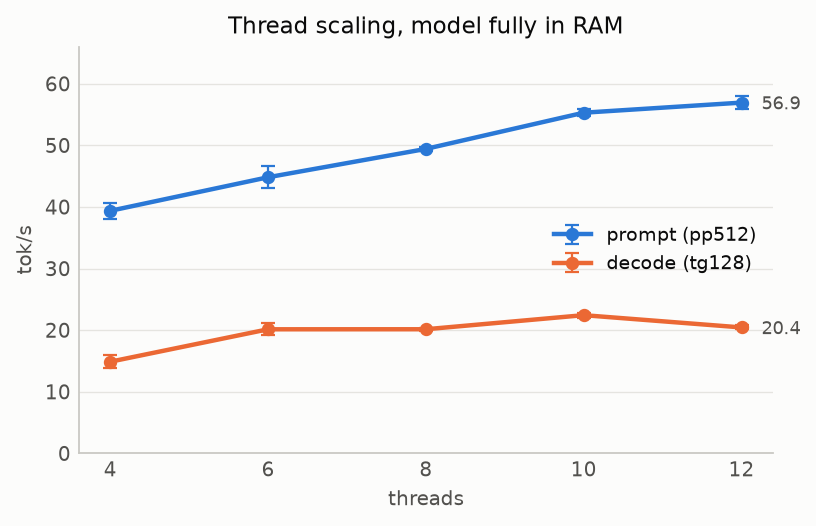
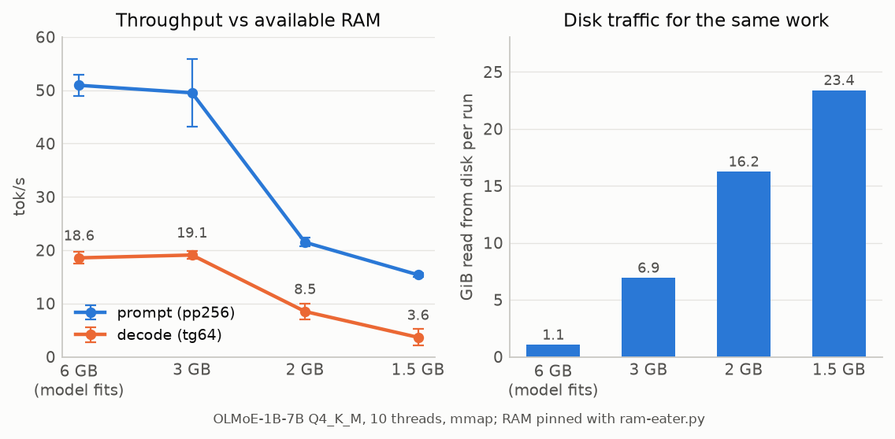
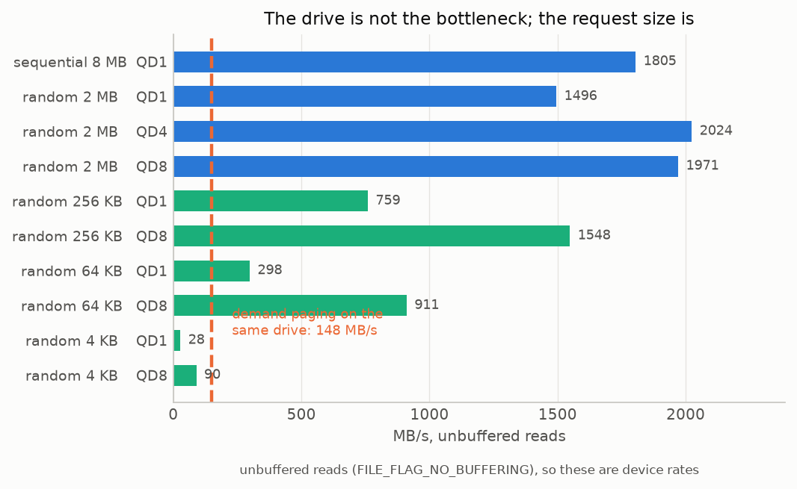
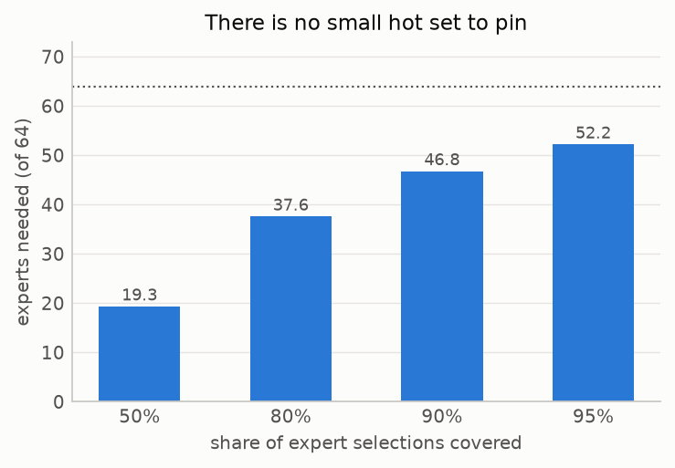
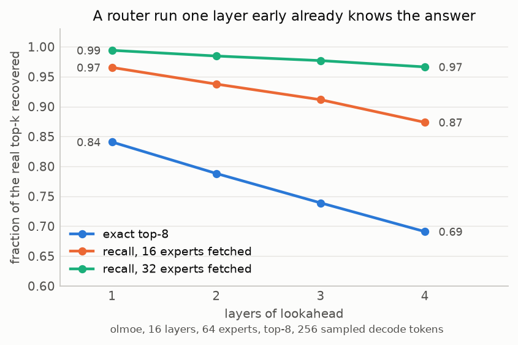
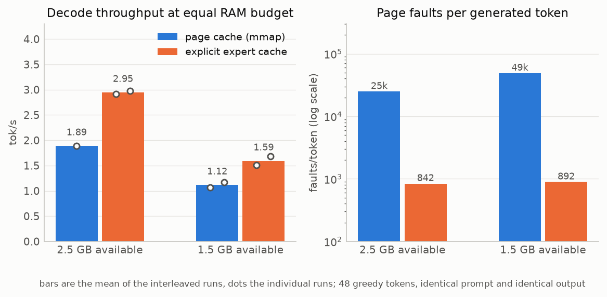
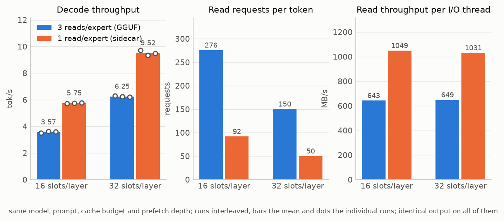
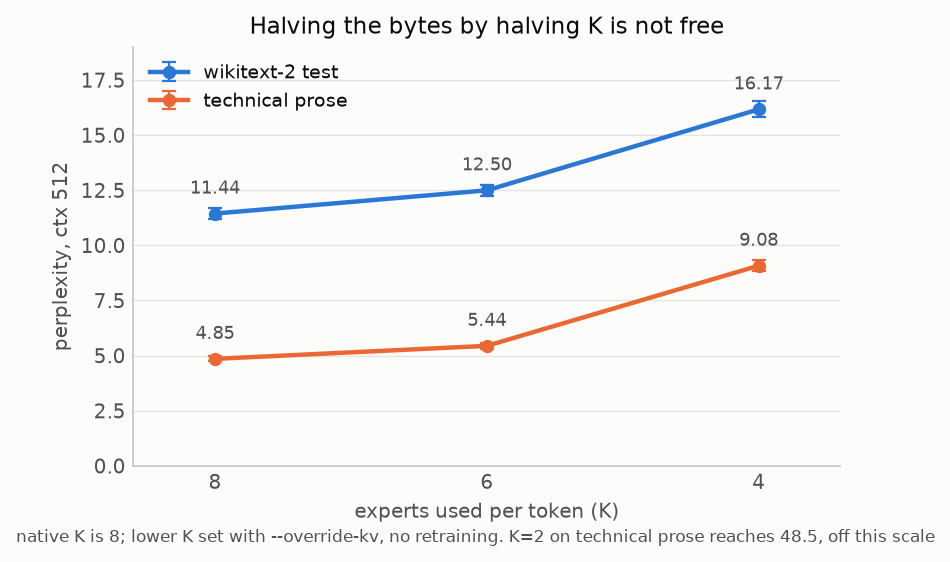

# Why a 16 GB laptop can't run a big MoE model from SSD, and what I built to fix it

A Mixture-of-Experts model only uses a few percent of its weights per token. A
30B-class MoE with 8 of 128 experts active touches maybe 3B parameters to
produce one token, which is well inside what a laptop CPU can compute. The
weights, though, are 20 GB or more, and I have 16 GB of RAM with about 7 GB
actually free.

The obvious plan is to leave the experts on the SSD and read the ones you need.
Everybody's first attempt is to let the operating system do it: memory-map the
file and let the page cache keep whatever fits. That is what llama.cpp does
today, and on this machine it gets about 150 MB/s out of a drive that will
happily do 1.5 GB/s. This is the story of measuring that gap and then closing
most of it.

Everything below was measured on one machine. I am not claiming these numbers
generalise, and where I think they do not, I say so.

## The machine and the model

All results come from this laptop (recorded in
[`bench/results/machine.json`](../bench/results/machine.json)):

| | |
|---|---|
| Dell Vostro 15 3530 | Windows 11 Pro 10.0.26200 |
| Intel Core i5-1334U | 2 P-cores + 8 E-cores, 12 threads, AVX2 and AVX-VNNI, no AVX-512 |
| 15.7 GB DDR4-3200, dual channel | roughly 7 to 8 GB free for a model in practice |
| Intel Iris Xe, shared memory | no discrete GPU, no NPU |
| Samsung BM9C1 512 GB NVMe | DRAM-less OEM PCIe 4 drive |

The subject is **OLMoE-1B-7B-0924-Instruct at Q4_K_M**: 16 layers, 64 experts
per layer, top-8 routing, 6.9B parameters, 3.92 GiB on disk. It is deliberately
small enough to fit in RAM, which makes it a control: I can simulate a smaller
machine by pinning memory with
[`bench/ram-eater.py`](../bench/ram-eater.py) and compare against the same model
running warm. Everything is CPU only, built from llama.cpp at commit `972d231`
with the patches in [`patches/`](../patches).

The conclusions are about the I/O path, so they should carry to a bigger model
on the same drive. I have not run a 30B-class MoE yet, and that is the main
open question at the end.

## Baseline: what you get for free

First, how fast is this CPU when nothing is missing? `llama-bench`, three
repetitions, model fully resident:



Prompt processing scales with threads up to 12 and tops out at 56.9 tok/s.
Decoding flattens at 6 threads and peaks at 22.4 tok/s with 10. Decode is
memory-bandwidth bound, not compute bound: about 1.3B active parameters at 4.5
bits is roughly 0.8 GB of weights per token, and 22 tok/s means around 18 GB/s
of effective DDR4 bandwidth, which is what this machine has. The useful
consequence is that during decoding roughly four cores sit idle. That is free
CPU for a prefetcher.

Now take the memory away. `bench/sweep-pressure.ps1` pins RAM so that a chosen
amount stays available, then runs the same pp256 and tg64 benchmark:



At 6 GB and at 3 GB available, nothing much happens: Windows answers the
pressure by paging *other* processes out, so the model stays resident and
throughput holds at 18 to 19 tok/s. Below that it falls off a cliff. At 1.5 GB
available, decoding runs at 3.65 tok/s and the same benchmark reads 23.4 GiB
from the disk, six times the size of the whole model, because experts are
evicted and re-read constantly.

The interesting number is the implied throughput. The 2 GB run moved 16.2 GiB
in 111 seconds and the 1.5 GB run moved 23.4 GiB in 163 seconds. Both work out
to about 148 MB/s.

## The drive is not the bottleneck

So I measured what the drive will actually do, with
[`bench/disk-bench.py`](../bench/disk-bench.py), reading with
`FILE_FLAG_NO_BUFFERING` so the numbers are the device and not the cache:



Expert-sized requests run near the drive's sequential speed. A random 2 MB read
at queue depth 1 gets 1496 MB/s, which is 83% of the 1805 MB/s this drive does
for sequential 8 MB reads, and queue depth 4 pushes it to 2024 MB/s. Go down to
page-fault-sized requests and it collapses: 298 MB/s for random 64 KB at QD1,
and 28 MB/s for random 4 KB.

That is the whole problem in one chart. Demand paging an mmap gets 148 MB/s
because it arrives as small, low-queue-depth requests, one minor fault at a
time. The same bytes fetched as whole experts would arrive ten times faster.
The page cache is not slow because the drive is slow. It is slow because
nothing tells it what to read, so it can only react to a fault that has already
happened, at the granularity of a page.

(These are the numbers from a re-run on 2026-10-07. An earlier run on
2026-09-18, recorded in [`NOTES.md`](NOTES.md) Results 4, gave 1194 MB/s for
random 2 MB QD1 and 1561 MB/s sequential. The difference is drive temperature,
which turns out to matter a lot on this laptop. More on that below.)

## Can you know which experts are coming?

To read an expert before it is needed, you have to know it will be needed. The
published answer is a trained predictor: a small network that looks at layer L
and guesses layer L+1's routing. Training one needs a GPU and a new artifact
per model, so I wanted to know how far you get with nothing.

I dumped the router's decisions for 256 sampled decode tokens with
`llama-moe-trace` and analysed them offline with
[`bench/analyze-trace.py`](../bench/analyze-trace.py).

The first thing I looked for was a hot set worth pinning in RAM. There isn't
one:



Covering 80% of selections needs 37.6 of the 64 experts on average, 95% needs
52.2, and all 64 are used within 256 tokens. OLMoE is trained with load
balancing and it shows. The practical consequence is that a cache holding a
fraction f of the experts hits roughly f of the time, so cache *policy* is a
small lever here. Temporal reuse is weak too: consecutive tokens share only 31%
of their experts at the same layer, so "same as last token" is a poor
predictor.

What does work is embarrassingly simple. The residual stream changes little
across a single FFN, so you can take the hidden state entering layer L's FFN
and apply layer L+d's own normalisation and router weights to it. No training,
no new parameters, just the router you already have, run early on a slightly
stale input:



One layer ahead it picks the exact top-8 correctly 84% of the time, and if you
fetch 16 experts instead of 8 you cover 97% of what the real router will pick.
Even four layers ahead, fetching 16 covers 87%. In-process it behaved
identically to the offline analysis: `llama-moe-run` reported 0.847 exact
top-8 at depth 1.

So prediction is not the hard part. A two to three layer lookahead window with
90%-plus recall is available for free on any MoE, which means Edge0-style
trained prerouters are not required to get most of the benefit.

## The attempt that failed

With prediction working, the cheap move is to keep the mmap and just tell the
operating system what is coming. On Windows that is `PrefetchVirtualMemory`:
hand it the byte ranges of the predicted experts and the kernel issues large
reads for them.

I built it: a `cb_eval` hook that runs the stale router when layer L's FFN
input is ready, predicts layers L+1 to L+depth, and hands the ranges to a
worker thread so the compute threads only pay for the routing arithmetic.

It bought almost nothing. Interleaved A/B/A/B runs, 48 greedy tokens:

| available RAM | baseline | prefetch d2 | baseline | prefetch d2 |
|---|---|---|---|---|
| 2 GB | 2.01 | 2.98 | 3.06 | 3.12 |
| 1.5 GB | 1.37 | 1.28 | 1.14 | 1.41 |

Between zero and 25% at moderate pressure, and nothing at all when memory is
really tight. Three measured reasons:

1. `PrefetchVirtualMemory` moves about 0.6 GB/s and walks every page of every
   range in the calling thread, around 0.16 ms per MB even for pages that are
   already resident. Called synchronously it blocked the compute thread for 170
   to 330 ms per token.
2. It cannot be parallelised. More prefetch threads made things worse (3.39
   tok/s with two threads against 4.76 with one), because the prefetch calls,
   the faulting compute threads and the memory manager all contend for the same
   process locks. Touching pages to pre-map them was worse still: 2.69 tok/s
   and soft faults up from 13k to 39k per token.
3. Under pressure the compute threads still took 48k hard faults per token,
   about one per 4 KB page, with no clustering. Prefetch does not change how
   those pages arrive. And pages that were prefetched got evicted before use,
   because the eviction policy is not mine to set.

Widening the prediction to 16 experts per layer was a clear loss (2.02 tok/s
against 4.33 at width 8): in a bandwidth-bound regime, buying recall with twice
the bytes is the wrong trade.

The conclusion I drew is that the page cache is the wrong engine for this. It
charges a fault per page, it cannot be steered into large parallel reads, and
it evicts what you prefetch. The 10x gap between demand paging and
expert-sized reads is only collectable by owning the I/O path.

## Owning the I/O path

So the experts moved into my own memory. The design:

- A per-layer cache of `C` slots, each holding one expert's matrices, allocated
  as an anonymous ggml CPU buffer and `VirtualLock`ed so the OS cannot page it
  out. Not file-backed, so the page cache is out of the picture entirely.
- A small I/O thread pool reading with `FILE_FLAG_NO_BUFFERING`, at expert
  granularity, with misses queued ahead of speculative prefetches.
- LRU eviction with the current token's slots pinned.
- The graph change that makes it possible: `build_moe_ffn` runs its three
  `mul_mat_id` calls against the cache tensors, addressed through a rewritable
  `ffn_moe_slot_ids` tensor. An eval callback resolves expert ids to slot
  indices just before the matmuls run, loading anything missing and waiting on
  anything in flight. Biases and LoRA keep the real expert ids, and prefill
  (where every expert gets used anyway) falls back to the mmap.

That is [`patches/0002-expert-cache-hook.patch`](../patches/0002-expert-cache-hook.patch)
plus [`tools/moe-run/expert_cache.cpp`](../tools/moe-run/expert_cache.cpp).

The correctness check that matters: the hash of the generated token ids must be
identical with and without the cache, same prompt, greedy sampling. It is, on
every cache configuration I have run.



At 2.5 GB available with 32 slots per layer (1.86 GiB locked), decoding went
from 1.89 tok/s to 2.92 and 2.98. At 1.5 GB with 16 slots (0.93 GiB), from 1.07
and 1.17 to 1.51 and 1.68. That is 1.56x and 1.42x at an equal RAM budget. Page
faults per token fell from 25k to 50k down to around 850.

Two things I want to be honest about here.

The first is that the RAM budget is only approximately a budget, and it favours
the page-cache side. `ram-eater.py` pins pages, but Windows responds by paging
other processes out, so "available memory" drifts during a run. One baseline run
at 2.5 GB recorded 28.6 tok/s and 31 faults per token, because by then the whole
model was resident. I left that run out of the chart and say so in the caption;
it is in [`ab.csv`](../bench/results/ab.csv) if you want it. The standby list can
grow into memory freed from other processes, while my locked cache cannot.

The second is that this drive throttles. The BM9C1 sustains 1.2 to 1.5 GB/s for
2 MB reads when cool and drops to 600 to 750 MB/s after a few minutes of
sustained random reading. I measured the same code on the same file swing by 2x
within minutes, repeatedly, in both Python and C++. Every A/B here is
interleaved so both sides see a similar drive state, and it is still the largest
source of noise in these measurements.

With the faults gone, the accounting is simple. At 32 slots the cache recorded
97 hits, 22 late hits (the prefetch was in flight and the main thread waited)
and 8 misses per token, reading 191 MB per token and blocking the main thread
for about 280 ms. 191 MB at the roughly 600 MB/s the drive was then sustaining
is 280 ms. The path is purely bandwidth-bound. Nothing about faults or policy
is left to fix; what is left is bytes and bandwidth.

## One read instead of three

Here is where the layout starts to matter. A GGUF stores the experts as three
stacked tensors, `ffn_up_exps`, `ffn_gate_exps` and `ffn_down_exps`. One
expert's three matrices are therefore three byte ranges in three different
places in the file, so fetching one expert costs three requests of 1.27 MB
each. From the chart above, 1.27 MB requests are good but not the drive's best:
at these sizes bigger is still better.

So I wrote a converter that puts each expert's matrices back to back. A valid
GGUF cannot express that, because every tensor there has to be one contiguous
blob and bundling interleaves bytes from three of them. The bundled copy
therefore lives in a sidecar file next to the model: the GGUF stays untouched
and loadable, and the cache reads whole experts out of the sidecar.
[`llama-moe-bundle`](../tools/moe-run/moe-bundle.cpp) writes it, verifies every
byte against the GGUF, and for this model produces a 3.63 GiB file of 1024
bundles with a stride of 3.38 to 3.89 MiB per expert (Q4_K_M uses different
quantisation types in different layers, so the stride varies).

Same model, same prompt, same cache budget, same prefetch depth, interleaved
runs, the only difference being which file the experts come from:



| cache | layout | tok/s (3 runs) | requests/token | MB/request | MB/s per I/O thread | I/O wait |
|---|---|---|---|---|---|---|
| 32 slots | split | 6.30 / 6.24 / 6.21 | 150.3 | 1.27 | 649 | 115 ms/token |
| 32 slots | **bundled** | **9.73 / 9.33 / 9.49** | **50.1** | **3.82** | **1031** | **62 ms/token** |
| 16 slots | split | 3.50 / 3.61 / 3.60 | 275.8 | 1.27 | 643 | 229 ms/token |
| 16 slots | **bundled** | **5.71 / 5.76 / 5.79** | **91.9** | **3.81** | **1049** | **127 ms/token**  |

**1.52x at 32 slots and 1.61x at 16 slots.** Requests per token fell by exactly
3x, as designed. Bytes read per token are identical on both sides (191.3 MB at
32 slots, 349.9 MB at 16), so this is purely the drive doing more with the same
bytes: per-thread read throughput went from around 645 MB/s to around 1040
MB/s, a 1.6x improvement that lines up with the request-size curve measured
independently. The token hash was `3b15dac0721bfcbf` on all twelve runs.

That is a bigger win than I expected. I had guessed 20 to 30% from the
disk-bench numbers, and the reason it is more is that the relevant comparison is
not "1.27 MB versus 3.82 MB at the same queue depth" but the real access
pattern, where three separate seeks per expert interleave badly across two I/O
threads.

Two caveats. These runs had no memory pinning. Both layouts read with
unbuffered I/O and the cache is locked, so neither side depends on the page
cache and pinning changes nothing about what is being compared. I did try it
anyway, and it did not go well: the one pinned sequence that completed, at 2.5
GB available, had per-thread throughput fall from 632 to 237 MB/s across four
consecutive runs as the drive heated, which is a larger effect than the one
being measured. Every later attempt failed to start, because `ram-eater.py` pins
whatever is free at the time, so on an idle machine it pinned 6 to 7 GB and the
locked cache no longer fit in what was left. I am reporting the unpinned runs as
the result because they are the controlled measurement, not because they are the
flattering one.

The other caveat is that the sidecar is a freshly written file, so some of the
gain could be physical placement on the drive rather than request size. I think
request size is doing the work, because requests per token fell exactly 3x and
per-request throughput rose in line with the independent disk benchmark, but I
have not isolated the two.

## The other lever, and why it is not free

If throughput is bytes per token divided by bandwidth, the other half of the
equation is bytes. The cheapest-looking trick is to route to fewer experts:
halving K from 8 to 4 halves the expert bytes with no code change at all, just
`--override-kv olmoe.expert_used_count=int:4`. Edge0 ships a 35B model that
does exactly this.

So I measured the quality cost with `llama-perplexity` on two corpora,
wikitext-2 test and a corpus of technical prose:



| K | expert bytes | wikitext-2 | technical prose |
|---|---|---|---|
| 8 (native) | 100% | 11.44 ± 0.23 | 4.85 ± 0.11 |
| 6 | 75% | 12.50 ± 0.26 (+9%) | 5.44 ± 0.14 (+12%) |
| 4 | 50% | 16.17 ± 0.36 (+41%) | 9.08 ± 0.26 (+87%) |
| 2 | 25% | not run | 48.5 ± 1.9 (10x) |

No, K=4 is not free. It costs 41% perplexity on wikitext-2 and 87% on technical
prose, and the curve is convex: each expert you remove hurts more than the last.
K=6 costs 9 to 12% for 25% fewer bytes, which is in the same range as dropping a
quantisation level, and is a legitimate knob. K=2 is dead.

This is the concrete case for Edge0's Recover-LoRA. Their K=4 works because
adapters were distilled against K=4 routing. Taken raw, the 2x I/O saving buys
you a much worse model. One caveat: OLMoE has 64 small experts and no shared
expert, which probably makes it more K-sensitive than a 256-expert model with a
shared expert carrying a baseline. The same sweep costs nothing to run on a
bigger model and should be run there before anyone trusts this number for it.

## Where this leaves things

Stacking up on this laptop, at a 1.86 GiB expert cache with the model about
half resident:

| | tok/s |
|---|---|
| page cache, mmap, 2.5 GB available | 1.89 |
| explicit expert cache, same budget | 2.92 to 2.98 |
| explicit cache, bundled layout, unpinned | 9.33 to 9.73 |

The last row is not directly comparable to the first two, because it was
measured without memory pinning and on a cooler drive. The comparable claims
are the two A/Bs I ran properly: 1.42x to 1.56x for owning the I/O path at an
equal RAM budget, and a further 1.52x to 1.61x for the bundled layout.

What I think the measurements actually establish:

1. The page cache cannot do this job, and the reason is request size, not drive
   speed. This is the biggest single factor and nobody gets it for free from
   the OS.
2. Prediction is solved without training. 84% exact and 97% recall at width 16,
   one layer ahead, from the router you already have.
3. Prefetching into the page cache does not work, however good the prediction.
4. Expert layout is worth about 1.5x on its own and costs nothing at inference
   time, only a conversion pass and disk space.
5. Cache policy barely matters when expert popularity is flat, which for a
   load-balanced model it is.

What is still open:

- **The real target.** Everything here is a 6.9B model used as a control. The
  thesis needs a 30B-class MoE, where the expert count is larger, there is often
  a shared expert that is always resident, and the popularity curve may not be
  flat. That is the next measurement and it may change the conclusions about
  cache policy.
- **The drive.** These results are bandwidth-bound on a DRAM-less laptop SSD
  that halves its own throughput when warm. The same code on a drive sustaining
  3 GB/s should be roughly 3x faster, and on this laptop a cooling pad is
  literally a performance feature.
- **Overlapped I/O.** The reader is synchronous per thread, so queue depth
  equals thread count. Real asynchronous I/O (IOCP, or io_uring on Linux) would
  let one thread hold the queue depth the drive likes, which the disk benchmark
  says is 2 to 4.
- **Linux.** The patches are platform-neutral but the I/O path is all Win32.
  Linux would also be a better measurement platform, because cgroups give a real
  memory limit instead of pinned pages, and `drop_caches` is reliable.

## Reproducing this

The repository holds only my own code: the harness, the tools and the patches.
[`SETUP.md`](../SETUP.md) rebuilds a working tree from scratch, which is a clone
of llama.cpp at the pinned commit, two patches, a build, and a 4 GB model
download. After that:

```
python bench/disk-bench.py C:\models\<model>.gguf --json bench/results/disk-bench.json
bench\run-bench.ps1       -Model C:\models\<model>.gguf -Threads "4,6,8,10,12"
bench\sweep-pressure.ps1  -Model C:\models\<model>.gguf -AvailableGB 6,3,2,1.5 -Threads 10
bench\ab-prefetch.ps1     -Model C:\models\<model>.gguf -AvailableGB 2.5 -Configs "0 8","2 8"
bench\ppl-k-sweep.ps1     -Model C:\models\<model>.gguf -Arch olmoe -Text <corpus> -K 8,6,4
llama-moe-bundle -m C:\models\<model>.gguf --verify
bench\ab-layout.ps1       -Model C:\models\<model>.gguf -Slots 32 -Rounds 3
```

Every figure in this article is generated by
[`bench/make-charts.py`](../bench/make-charts.py) from the measurement files in
[`bench/results/`](../bench/results), so the charts and the raw data cannot
drift apart. [`NOTES.md`](NOTES.md) has every result in the order I measured
it, including the things that did not work and why.
